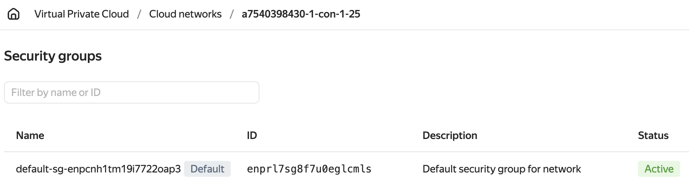
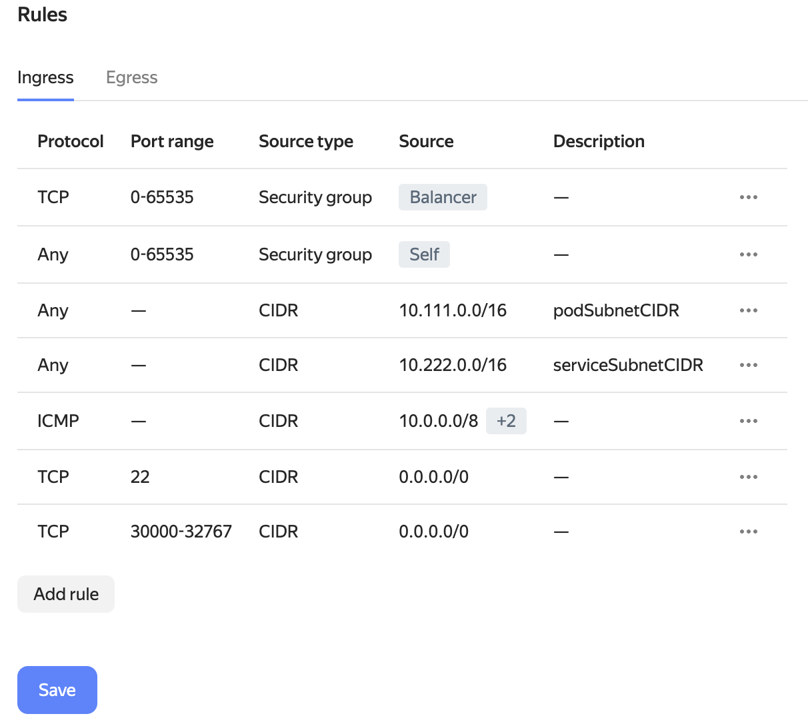




The provider supports working with only one disk in the virtual machine template. Make sure the template contains only one disk.


## Creating a service account

You need to create a service account with the editor role with the cloud provider so that Deckhouse Platform (DP) can manage cloud resources. The detailed instructions for creating a service account with Yandex Cloud are available [in the provider's documentation](https://cloud.yandex.com/en/docs/resource-manager/operations/cloud/set-access-bindings). Below, we will provide a brief overview of the necessary actions:

1. Create a user named `deckhouse`:

   ```shell
   yc iam service-account create --name deckhouse
   ```

   The command output will contain its parameters:

   ```console
   id: <USER_ID>
   folder_id: <FOLDER_ID>
   created_at: "YYYY-MM-DDTHH:MM:SSZ"
   name: deckhouse
   ```

1. Assign the required roles to the newly created user for your cloud:

   ```shell
   yc resource-manager folder add-access-binding --id <FOLDER_ID> --role compute.editor --subject serviceAccount:<USER_ID>
   yc resource-manager folder add-access-binding --id <FOLDER_ID> --role vpc.admin --subject serviceAccount:<USER_ID>
   yc resource-manager folder add-access-binding --id <FOLDER_ID> --role load-balancer.editor --subject serviceAccount:<USER_ID>
   ```

1. Create a JSON file containing the parameters for user authorization in the cloud. These parameters will be used to log in to the cloud:

   ```shell
   yc iam key create --service-account-name deckhouse --output deckhouse-sa-key.json
   ```


A new cluster may require increased [quotas](#quotas). If necessary, also reserve a public IP address as described in ["Reserving a public IP address"](faq.html#reserving-a-public-ip-address).


## Credentials Secret

The service account key is stored in a separate Secret rather than in [ModuleConfig](/products/kubernetes-platform/documentation/v1/reference/api/cr.html#moduleconfig). The provider reads it when starting the components that access the Yandex Cloud API.

The Secret is created during cluster installation together with the other resources of the initial configuration. If the provider is connected to a running cluster, the Secret is applied after the module creates the namespace. The Secret must meet the following requirements:

- The name is `d8-credentials` and the namespace is `d8-cloud-provider-yandex`.
- The type is `cloud-provider.deckhouse.io/credentials`.
- The `authScheme` field is set to `serviceAccount`.
- The `secret` field contains the service account key in JSON.

```yaml
apiVersion: v1
kind: Secret
metadata:
  name: d8-credentials
  namespace: d8-cloud-provider-yandex
type: cloud-provider.deckhouse.io/credentials
stringData:
  authScheme: serviceAccount
  secret: |
    <SERVICE_ACCOUNT_JSON>
```

Replace `<SERVICE_ACCOUNT_JSON>` with the contents of the `deckhouse-sa-key.json` file.

To change the credentials, update the `secret` field:

```shell
d8 k -n d8-cloud-provider-yandex edit secret d8-credentials
```

In the ["WithNATInstance layout"](layouts.html#withnatinstance), the API key for monitoring the NAT instance is stored in a second Secret, `d8-credentials-exporter`, in the same namespace. Its `authScheme` field is set to `apiToken` and the key is placed in the `secret` field.

In clusters migrated to ModuleConfig, the service account key moves to the `d8-credentials` Secret from the [`provider.serviceAccountJSON`](cluster_configuration.html#yandexclusterconfiguration-provider-serviceaccountjson) parameter of the [YandexClusterConfiguration](cluster_configuration.html#yandexclusterconfiguration) resource. The monitoring API key moves to the `d8-credentials-exporter` Secret from the [`withNATInstance.exporterAPIKey`](cluster_configuration.html#yandexclusterconfiguration-withnatinstance-exporterapikey) parameter.

## Quotas

> Note that you need to increase the quotas using the Yandex console when provisioning a new cluster.

Recommended quotas for a new cluster:

- The number of virtual processors: 64.
- The total volume of SSD disks: 2000 GB.
- The number of virtual machines: 25.
- The total amount of RAM of virtual machines: 256 GB.

## Yandex Cloud integration


Starting with DP version 1.77, Yandex Cloud uses the `cilium` CNI by default for new clusters. Existing clusters keep the current CNI configuration.

New clusters require Linux kernel version 5.8 or newer on all nodes. Make sure firewalls or security groups allow inter-node UDP traffic for Cilium VXLAN. For details, see the [installation requirements](/products/kubernetes-platform/documentation/v1/installing/), ["Network interaction of the platform components"](/products/kubernetes-platform/documentation/v1/reference/network_interaction.html), and the [`cni-cilium` module documentation](/modules/cni-cilium/).


### Configuring security groups

For every [cloud network](https://cloud.yandex.com/en/docs/vpc/concepts/network#network), Yandex Cloud creates a [default security group](https://cloud.yandex.com/en/docs/vpc/concepts/security-groups), including for the cluster network. That group allows any inbound and outbound traffic and applies to the virtual machine network interfaces that are not assigned another group.

You can restrict the cluster traffic with the rules of that group. Assigning another security group to the nodes is not possible, as neither the module settings nor the YandexInstanceClass resource have parameters for that.


Do not assign security groups to the nodes manually in the Yandex Cloud console. The `dhctl converge` command brings the virtual machines to the state described in the cluster configuration and may remove such an assignment.



Do not delete the rules that allow any traffic until you have configured the other rules of the group. Otherwise, the group blocks the traffic between the nodes and the cluster components lose connection to each other.


Errors in the rules disrupt the cluster. Before configuring the rules in a production cluster, consult the [security group usage details](https://cloud.yandex.com/en/docs/vpc/concepts/security-groups#security-groups-notes) in Yandex Cloud.

If the cluster uses `cilium` in VXLAN mode, make sure the security group allows inter-node UDP traffic on the ports required for Cilium. These ports are listed in ["Network interaction of the platform components"](/products/kubernetes-platform/documentation/v1/reference/network_interaction.html).

To configure the rules of the security group:

1. Find out in which cloud network the Deckhouse Platform cluster is running.

   The network name matches the [`prefix`](/products/kubernetes-platform/documentation/v1/reference/api/global.html#parameters-prefix) parameter of the ModuleConfig `global`.
   You can retrieve it using the following command:

   ```bash
   d8 k get mc global -o jsonpath='{.spec.settings.prefix}{"\n"}'
   ```

   If the value is empty, get it from the deprecated [`cloud.prefix`](/products/kubernetes-platform/documentation/v1/reference/api/cr.html#clusterconfiguration-cloud-prefix) parameter of ClusterConfiguration (the prefix has moved to the ModuleConfig `global`):

   ```bash
   d8 k get secrets -n kube-system d8-cluster-configuration -ojson | \
     jq -r '.data."cluster-configuration.yaml"' | base64 -d | grep prefix | cut -d: -f2
   ```

1. In the Yandex Cloud console, select the Virtual Private Cloud service and navigate to the "Security Groups" section. You should see a single security group labeled `Default`.

   

1. Create rules as described [in Yandex Cloud instructions](https://cloud.yandex.com/en/docs/managed-kubernetes/operations/connect/security-groups#rules-internal).

   

1. Delete the rule that allows for any **inbound** traffic (in the screenshot above it has already been deleted), and save the changes.

### Yandex Lockbox integration

The [External Secrets Operator](https://github.com/external-secrets/external-secrets) allows you to synchronize [Yandex Lockbox](https://cloud.yandex.com/en/docs/lockbox/concepts/) secrets with the Deckhouse Platform cluster secrets.

The instructions below are meant to be viewed as a _Quick Start_ guide. To use integration in production environments, please review the following resources:

- [Yandex Lockbox](https://cloud.yandex.com/en/docs/lockbox/)
- [Synchronizing with Yandex Lockbox secrets](https://cloud.yandex.com/en/docs/managed-kubernetes/tutorials/kubernetes-lockbox-secrets)
- [External Secrets Operator](https://external-secrets.io/latest/)

#### Deployment instructions

1. [Create a service account](https://cloud.yandex.com/en/docs/iam/operations/sa/create) required for the External Secrets Operator:

   ```shell
   yc iam service-account create --name eso-service-account
   ```

1. [Create an authorized key](https://cloud.yandex.com/en/docs/iam/operations/authorized-key/create) for the service account and save it to a file:

   ```shell
   yc iam key create --service-account-name eso-service-account --output authorized-key.json
   ```

1. [Assign](https://cloud.yandex.com/en/docs/iam/operations/sa/assign-role-for-sa) `lockbox.editor`, `lockbox.payloadViewer`, and `kms.keys.encrypterDecrypter` [roles](https://cloud.yandex.com/en/docs/lockbox/security/#service-roles) to a service account to access all catalog secrets:

   ```shell
   folder_id=<FOLDER_ID>
   yc resource-manager folder add-access-binding --id=${folder_id} --service-account-name eso-service-account --role lockbox.editor
   yc resource-manager folder add-access-binding --id=${folder_id} --service-account-name eso-service-account --role lockbox.payloadViewer
   yc resource-manager folder add-access-binding --id=${folder_id} --service-account-name eso-service-account --role kms.keys.encrypterDecrypter
   ```

   For advanced customization, check out [access control in Yandex Lockbox](https://cloud.yandex.com/en/docs/lockbox/security).

1. Install the External Secrets Operator using the Helm chart according [to instructions](https://cloud.yandex.com/en/docs/managed-kubernetes/operations/applications/external-secrets-operator#helm-install).

   Note that you may need to set `nodeSelector`, `tolerations` and other parameters. To do this, use the `./external-secrets/values.yaml` file after unpacking the Helm chart.

   Pull and extract the chart:

   ```shell
   helm pull oci://cr.yandex/yc-marketplace/yandex-cloud/external-secrets/chart/external-secrets \
     --version 0.5.5 \
     --untar
   ```

   Install the Helm chart:

   ```shell
   helm install -n external-secrets --create-namespace \
     --set-file auth.json=authorized-key.json \
     external-secrets ./external-secrets/
   ```

   Where:
   - `authorized-key.json` — the name of the file with the authorized key from step 2.

1. Create a [SecretStore](https://external-secrets.io/latest/api/secretstore/) with the `sa-creds` secret in it:

   ```shell
   d8 k -n external-secrets apply -f - <<EOF

   apiVersion: external-secrets.io/v1alpha1
   kind: SecretStore
   metadata:
     name: secret-store
   spec:
     provider:
       yandexlockbox:
         auth:
           authorizedKeySecretRef:
             name: sa-creds
             key: key
   EOF
   ```

   Where:
   - `sa-creds` — the name of the Secret that contains the authorized key. This secret should show up after the Helm chart has been installed.
   - `key` — the name of the key in the `.data` field of the secret above.

#### Checking that everything works as expected

1. Check the status of the External Secrets Operator:

   ```shell
   d8 k -n external-secrets get po
   ```

   An example of the output:

   ```console
   NAME                                                READY   STATUS    RESTARTS   AGE
   external-secrets-55f78c44cf-dbf6q                   1/1     Running   0          77m
   external-secrets-cert-controller-78cbc7d9c8-rszhx   1/1     Running   0          77m
   external-secrets-webhook-6d7b66758-s7v9c            1/1     Running   0          77m
   ```

1. Check the state of the secrets store you created:

   ```shell
   d8 k -n external-secrets get secretstores.external-secrets.io
   ```

   An example of the output:

   ```console
   NAME           AGE   STATUS
   secret-store   69m   Valid
   ```

1. [Create](https://cloud.yandex.com/en/docs/lockbox/operations/secret-create) a Yandex Lockbox secret with the following parameters:
   - **Name** — `lockbox-secret`.
   - **Key** — enter the non-confidential identifier `password`.
   - **Value** — enter the confidential data to store `p@$$w0rd`.

1. Create an [ExternalSecret](https://external-secrets.io/latest/api/externalsecret/) object that refers to the `lockbox-secret` secret in the `secret-store`:

   ```shell
   d8 k -n external-secrets apply -f - <<EOF

   apiVersion: external-secrets.io/v1alpha1
   kind: ExternalSecret
   metadata:
     name: external-secret
   spec:
     refreshInterval: 1h
     secretStoreRef:
       name: secret-store
       kind: SecretStore
     target:
       name: k8s-secret
     data:
     - secretKey: password
       remoteRef:
         key: <SECRET_ID>
         property: password
   EOF
   ```

   Where:
   - `spec.target.name` — the name of the new secret. The External Secrets Operator will create this secret in the Deckhouse Platform cluster and populate it with the parameters of the Yandex Lockbox's `lockbox-secret`.
   - `spec.data[].secretKey` — the name of the key in the `.data` field of the secret that the External Secrets Operator will create.
   - `spec.data[].remoteRef.key` — identifier of the Yandex Lockbox's `lockbox-secret` created earlier, e.g., `e6q28nvfmhu539******`.
   - `spec.data[].remoteRef.property` — the **key** you specified earlier for the Yandex Lockbox's `lockbox-secret`.

1. Make sure that the new `k8s-secret` key contains the `lockbox-secret` value:

   ```shell
   d8 k -n external-secrets get secret k8s-secret -ojson | jq -r '.data.password' | base64 -d
   ```

   The output of the command should contain the **value** of the `password` key of the `lockbox-secret` created earlier:

   ```console
   p@$$w0rd
   ```

### Yandex Managed Service for Prometheus integration

This integration lets you use [the Yandex Managed Service for Prometheus](https://cloud.yandex.com/en/docs/monitoring/operations/prometheus/) as an external metrics repository, e.g., for long-term metrics storage.

#### Writing metrics

1. [Create a service account](https://cloud.yandex.com/en/docs/iam/operations/sa/create) with the `monitoring.editor` role.
1. [Create an API key](https://cloud.yandex.com/en/docs/iam/operations/api-key/create) for the service account.
1. Create a PrometheusRemoteWrite resource:

   ```shell
   d8 k apply -f - <<EOF
   apiVersion: deckhouse.io/v1
   kind: PrometheusRemoteWrite
   metadata:
     name: yc-remote-write
   spec:
     url: <URL_TO_WRITE_METRICS>
     bearerToken: <API_KEY>
   EOF
   ```

   Where:
   - `<URL_TO_WRITE_METRICS>` — URL from the Yandex Monitoring/Prometheus/Writing Metrics page.
   - `<API_KEY>` — the API key you created in the previous step, e.g., `AQVN1HHJRSrfo9jU3aopsXrJyfq_UHs********`.

   You may also specify additional parameters; refer to [the documentation](/modules/prometheus/cr.html#prometheusremotewrite).

More details about this feature can be found [in Yandex Cloud documentation](https://cloud.yandex.com/en/docs/monitoring/operations/prometheus/ingestion/remote-write).

#### Reading metrics with Grafana

1. [Create a service account](https://cloud.yandex.com/en/docs/iam/operations/sa/create) with the `monitoring.viewer` role.
1. [Create an API key](https://cloud.yandex.com/en/docs/iam/operations/api-key/create) for the service account.
1. Create a GrafanaAdditionalDatasource resource:

   ```shell
   d8 k apply -f - <<EOF

   apiVersion: deckhouse.io/v1
   kind: GrafanaAdditionalDatasource
   metadata:
     name: managed-prometheus
   spec:
     type: prometheus
     access: Proxy
     url: <URL_READING_METRICS_WITH_GRAFANA>
     basicAuth: false
     jsonData:
       timeInterval: 30s
       httpMethod: POST
       httpHeaderName1: Authorization
     secureJsonData:
       httpHeaderValue1: Bearer <API_KEY>
   EOF
   ```

   Where:
   - `<URL_READING_METRICS_WITH_GRAFANA>` — URL from the Yandex Monitoring/Prometheus/Reading Metrics with Grafana page.
   - `<API_KEY>` — the API key you created in the previous step, e.g., `AQVN1HHJReSrfo9jU3aopsXrJyfq_UHs********`.

   You may also specify additional parameters; refer to [the documentation](/modules/prometheus/cr.html#grafanaadditionaldatasource).

More details about this feature can be found [in Yandex Cloud documentation](https://cloud.yandex.com/en/docs/monitoring/operations/prometheus/querying/grafana).
