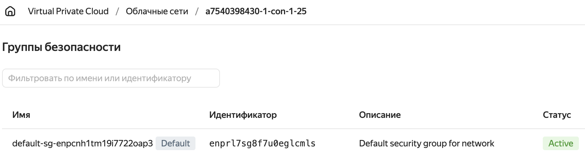
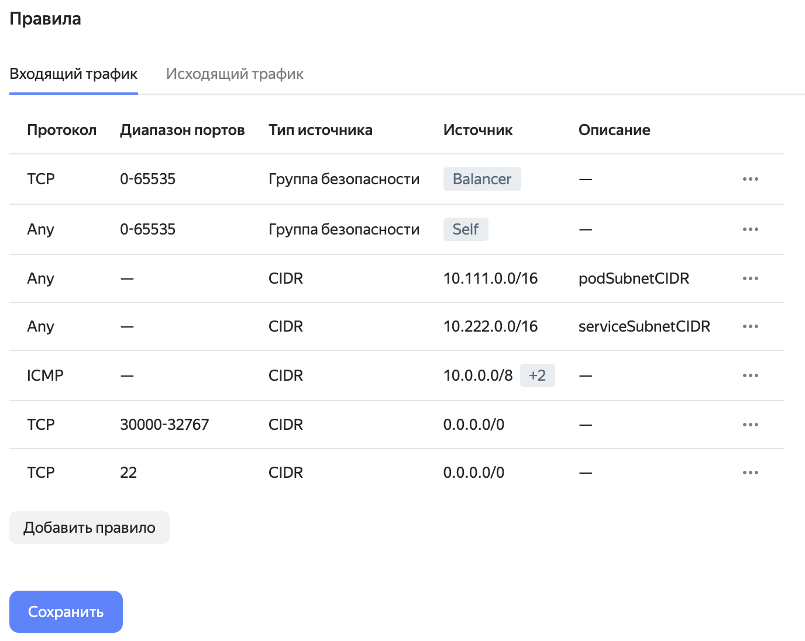




Провайдер поддерживает работу только с одним диском в шаблоне виртуальной машины. Убедитесь, что шаблон содержит только один диск.


## Создание сервисного аккаунта

Чтобы Deckhouse Platform (DP) могла управлять ресурсами в облаке Yandex Cloud, необходимо создать сервисный аккаунт и выдать ему права на редактирование. Подробная инструкция по созданию сервисного аккаунта в Yandex Cloud доступна в [документации провайдера](https://cloud.yandex.com/en/docs/resource-manager/operations/cloud/set-access-bindings). Далее представлена краткая последовательность необходимых действий:

1. Создайте пользователя с именем `deckhouse`:

   ```shell
   yc iam service-account create --name deckhouse
   ```

   В ответ вернутся параметры пользователя:

   ```console
   id: <USER_ID>
   folder_id: <FOLDER_ID>
   created_at: "YYYY-MM-DDTHH:MM:SSZ"
   name: deckhouse
   ```

1. Назначьте необходимые роли вновь созданному пользователю для своего облака:

   ```shell
   yc resource-manager folder add-access-binding --id <FOLDER_ID> --role compute.editor --subject serviceAccount:<USER_ID>
   yc resource-manager folder add-access-binding --id <FOLDER_ID> --role vpc.admin --subject serviceAccount:<USER_ID>
   yc resource-manager folder add-access-binding --id <FOLDER_ID> --role load-balancer.editor --subject serviceAccount:<USER_ID>
   ```

1. Создайте JSON-файл с параметрами авторизации пользователя в облаке. В дальнейшем с помощью этих данных будет происходить авторизация в облаке:

   ```shell
   yc iam key create --service-account-name deckhouse --output deckhouse-sa-key.json
   ```


Для нового кластера может потребоваться увеличение [квот](#квоты). При необходимости также зарезервируйте публичный IP-адрес, как описано в разделе [«Резервирование публичного IP-адреса»](faq.html#резервирование-публичного-ip-адреса).


## Секрет с учётными данными

Ключ сервисного аккаунта хранится не в [ModuleConfig](/products/kubernetes-platform/documentation/v1/reference/api/cr.html#moduleconfig), а в отдельном секрете. Провайдер читает его при запуске компонентов, которые обращаются к API Yandex Cloud.

Секрет создаётся при установке кластера вместе с остальными ресурсами первичной конфигурации. Если провайдер подключается к уже работающему кластеру, секрет применяется после того, как модуль создаст неймспейс. Секрет должен отвечать следующим требованиям:

- имя `d8-credentials`, неймспейс `d8-cloud-provider-yandex`;
- тип `cloud-provider.deckhouse.io/credentials`;
- поле `authScheme` со значением `serviceAccount`;
- поле `secret` с содержимым JSON-ключа сервисного аккаунта.

```yaml
apiVersion: v1
kind: Secret
metadata:
  name: d8-credentials
  namespace: d8-cloud-provider-yandex
type: cloud-provider.deckhouse.io/credentials
stringData:
  authScheme: serviceAccount
  secret: |
    <SERVICE_ACCOUNT_JSON>
```

Замените `<SERVICE_ACCOUNT_JSON>` на содержимое файла `deckhouse-sa-key.json`.

Чтобы сменить учётные данные, обновите поле `secret`:

```shell
d8 k -n d8-cloud-provider-yandex edit secret d8-credentials
```

В [схеме размещения WithNATInstance](layouts.html#withnatinstance) API-ключ для мониторинга NAT-инстанса хранится во втором секрете `d8-credentials-exporter` в том же неймспейсе. У него поле `authScheme` со значением `apiToken`, а ключ записан в поле `secret`.

В кластерах, переведённых на ModuleConfig, ключ сервисного аккаунта переносится в секрет `d8-credentials` из параметра [`provider.serviceAccountJSON`](cluster_configuration.html#yandexclusterconfiguration-provider-serviceaccountjson) ресурса [YandexClusterConfiguration](cluster_configuration.html#yandexclusterconfiguration). API-ключ мониторинга переносится в секрет `d8-credentials-exporter` из параметра [`withNATInstance.exporterAPIKey`](cluster_configuration.html#yandexclusterconfiguration-withnatinstance-exporterapikey).

## Квоты

При заказе нового кластера необходимо увеличить квоты в консоли Yandex Cloud.

Рекомендованные значения квот при создании нового кластера:

* Количество виртуальных процессоров: 64.
* Общий объем SSD-дисков: 2000 ГБ.
* Количество виртуальных машин: 25.
* Общий объем RAM виртуальных машин: 256 ГБ.

## Интеграция с Yandex Cloud


Начиная с DP 1.77, для новых кластеров в Yandex Cloud по умолчанию используется CNI `cilium`. В существующих кластерах текущая конфигурация CNI сохраняется.

Для новых кластеров на всех узлах требуется ядро Linux версии 5.8 или новее. Также убедитесь, что правила межсетевого экрана разрешают межузловой UDP-трафик, необходимый для работы Cilium VXLAN.

Подробнее в разделах [«Требования к установке»](/products/kubernetes-platform/documentation/v1/installing/), [«Сетевое взаимодействие компонентов платформы»](/products/kubernetes-platform/documentation/v1/reference/network_interaction.html) и [документации модуля `cni-cilium`](/modules/cni-cilium/).


### Настройка групп безопасности

Для каждой [облачной сети](https://cloud.yandex.ru/ru/docs/vpc/concepts/network#network) Yandex Cloud создаёт [группу безопасности](https://cloud.yandex.ru/ru/docs/vpc/concepts/security-groups) по умолчанию, в том числе для сети кластера. Эта группа разрешает любой входящий и исходящий трафик и применяется к тем сетевым интерфейсам виртуальных машин, которым не назначена другая группа.

Ограничить трафик кластера можно правилами этой группы. Назначить узлам другую группу безопасности нельзя, параметров для этого нет ни в настройках модуля, ни в ресурсе YandexInstanceClass.


Не назначайте группы безопасности узлам вручную в консоли Yandex Cloud. Команда `dhctl converge` приводит виртуальные машины к состоянию, описанному в конфигурации кластера, и может снять такую привязку.



Не удаляйте правила, разрешающие любой трафик, пока не настроите остальные правила группы. Иначе группа заблокирует трафик между узлами и компоненты кластера потеряют связь друг с другом.


Ошибки в правилах нарушают работу кластера. Перед настройкой правил в production-кластере изучите [особенности работы групп безопасности](https://cloud.yandex.ru/ru/docs/vpc/concepts/security-groups#security-groups-notes) в Yandex Cloud.

Если в кластере используется `cilium` в режиме VXLAN, убедитесь, что группа безопасности разрешает межузловой UDP-трафик на портах, необходимых Cilium. Эти порты перечислены в разделе [«Сетевое взаимодействие компонентов платформы»](/products/kubernetes-platform/documentation/v1/reference/network_interaction.html).

Чтобы настроить правила группы безопасности:

1. Определите облачную сеть, в которой работает кластер Deckhouse Platform.

   Название сети совпадает с параметром [`prefix`](/products/kubernetes-platform/documentation/v1/reference/api/global.html#parameters-prefix) ModuleConfig `global`.
   Его можно узнать с помощью команды:

   ```bash
   d8 k get mc global -o jsonpath='{.spec.settings.prefix}{"\n"}'
   ```

   Если значение пустое, возьмите его из устаревшего параметра [`cloud.prefix`](/products/kubernetes-platform/documentation/v1/reference/api/cr.html#clusterconfiguration-cloud-prefix) ресурса ClusterConfiguration (префикс перенесён в ModuleConfig `global`):

   ```bash
   d8 k get secrets -n kube-system d8-cluster-configuration -ojson | \
     jq -r '.data."cluster-configuration.yaml"' | base64 -d | grep prefix | cut -d: -f2
   ```

1. В консоли Yandex Cloud выберите сервис Virtual Private Cloud и перейдите в раздел «Группы безопасности». У вас должна отображаться одна группа безопасности с пометкой `Default`.

   

1. Создайте правила согласно [инструкции Yandex Cloud](https://cloud.yandex.ru/ru/docs/managed-kubernetes/operations/connect/security-groups#rules-internal).

   

1. Удалите правило, разрешающее любой **входящий** трафик (на скриншоте выше оно уже удалено), и сохраните изменения.

### Интеграция с Yandex Lockbox

С помощью инструмента [External Secrets Operator](https://github.com/external-secrets/external-secrets) вы можете настроить синхронизацию секретов [Yandex Lockbox](https://cloud.yandex.com/ru/docs/lockbox/concepts/) с секретами кластера Deckhouse Platform.

Приведенную инструкцию следует рассматривать как *Быстрый старт*. Для использования интеграции в продуктивных средах ознакомьтесь со следующими ресурсами:

- [Yandex Lockbox](https://cloud.yandex.ru/ru/docs/lockbox/)
- [Синхронизация с секретами Yandex Lockbox](https://cloud.yandex.ru/ru/docs/managed-kubernetes/tutorials/kubernetes-lockbox-secrets)
- [External Secrets Operator](https://external-secrets.io/latest/)

#### Инструкция по развертыванию

1. [Создайте сервисный аккаунт](https://cloud.yandex.com/ru/docs/iam/operations/sa/create), необходимый для работы External Secrets Operator:

   ```shell
   yc iam service-account create --name eso-service-account
   ```

1. [Создайте авторизованный ключ](https://cloud.yandex.ru/ru/docs/iam/operations/authorized-key/create) для сервисного аккаунта и сохраните его в файл:

   ```shell
   yc iam key create --service-account-name eso-service-account --output authorized-key.json
   ```

1. [Назначьте](https://cloud.yandex.ru/ru/docs/iam/operations/sa/assign-role-for-sa) сервисному аккаунту [роли](https://cloud.yandex.com/ru/docs/lockbox/security/#service-roles) `lockbox.editor`, `lockbox.payloadViewer` и `kms.keys.encrypterDecrypter` для доступа ко всем секретам каталога:

   ```shell
   folder_id=<FOLDER_ID>
   yc resource-manager folder add-access-binding --id=${folder_id} --service-account-name eso-service-account --role lockbox.editor
   yc resource-manager folder add-access-binding --id=${folder_id} --service-account-name eso-service-account --role lockbox.payloadViewer
   yc resource-manager folder add-access-binding --id=${folder_id} --service-account-name eso-service-account --role kms.keys.encrypterDecrypter
   ```

   Для более тонкой настройки ознакомьтесь [с управлением доступом в Yandex Lockbox](https://cloud.yandex.com/ru/docs/lockbox/security).

1. Установите External Secrets Operator с помощью Helm-чарта согласно [инструкции](https://cloud.yandex.com/ru/docs/managed-kubernetes/operations/applications/external-secrets-operator#helm-install).

   Обратите внимание, что вам может понадобиться задать `nodeSelector`, `tolerations` и другие параметры. Для этого используйте файл `./external-secrets/values.yaml` после распаковки Helm-чарта.

   Скачайте и распакуйте чарт:

   ```shell
   helm pull oci://cr.yandex/yc-marketplace/yandex-cloud/external-secrets/chart/external-secrets \
     --version 0.5.5 \
     --untar
   ```

   Установите Helm-чарт:

   ```shell
   helm install -n external-secrets --create-namespace \
     --set-file auth.json=authorized-key.json \
     external-secrets ./external-secrets/
   ```

   Где:

   - `authorized-key.json` — название файла с авторизованным ключом из шага 2.

1. Создайте хранилище секретов [SecretStore](https://external-secrets.io/latest/api/secretstore/), содержащее секрет `sa-creds`:

   ```shell
   d8 k -n external-secrets apply -f - <<EOF

   apiVersion: external-secrets.io/v1alpha1
   kind: SecretStore
   metadata:
     name: secret-store
   spec:
     provider:
       yandexlockbox:
         auth:
           authorizedKeySecretRef:
             name: sa-creds
             key: key
   EOF
   ```

   Где:

   - `sa-creds` — название Secret, содержащий авторизованный ключ. Этот секрет должен появиться после установки Helm-чарта.
   - `key` — название ключа в поле `.data` секрета выше.

#### Проверка работоспособности

1. Проверьте статус External Secrets Operator:

   ```shell
   d8 k -n external-secrets get po
   ```

   Пример вывода:

   ```console
   NAME                                                READY   STATUS    RESTARTS   AGE
   external-secrets-55f78c44cf-dbf6q                   1/1     Running   0          77m
   external-secrets-cert-controller-78cbc7d9c8-rszhx   1/1     Running   0          77m
   external-secrets-webhook-6d7b66758-s7v9c            1/1     Running   0          77m
   ```

1. Проверьте состояние созданного хранилища секретов:

   ```shell
   d8 k -n external-secrets get secretstores.external-secrets.io
   ```

   Пример вывода:

   ```console
   NAME           AGE   STATUS
   secret-store   69m   Valid
   ```

1. [Создайте секрет](https://cloud.yandex.ru/ru/docs/lockbox/operations/secret-create) Yandex Lockbox со следующими параметрами:

   - **Имя** — `lockbox-secret`.
   - **Ключ** — введите неконфиденциальный идентификатор `password`.
   - **Значение** — введите конфиденциальные данные для хранения `p@$$w0rd`.

1. Создайте объект [ExternalSecret](https://external-secrets.io/latest/api/externalsecret/), указывающий на секрет `lockbox-secret` в хранилище `secret-store`:

   ```shell
   d8 k -n external-secrets apply -f - <<EOF

   apiVersion: external-secrets.io/v1alpha1
   kind: ExternalSecret
   metadata:
     name: external-secret
   spec:
     refreshInterval: 1h
     secretStoreRef:
       name: secret-store
       kind: SecretStore
     target:
       name: k8s-secret
     data:
     - secretKey: password
       remoteRef:
         key: <SECRET_ID>
         property: password
   EOF
   ```

   Где:

   - `spec.target.name` — имя нового секрета. External Secrets Operator создаст этот секрет в кластере Deckhouse Platform и поместит в него параметры секрета Yandex Lockbox `lockbox-secret`.
   - `spec.data[].secretKey` — название ключа в поле `.data` секрета, который создаст External Secrets Operator.
   - `spec.data[].remoteRef.key` — идентификатор созданного ранее секрета Yandex Lockbox `lockbox-secret`. Например, `e6q28nvfmhu539******`.
   - `spec.data[].remoteRef.property` — **ключ**, указанный ранее, для секрета Yandex Lockbox `lockbox-secret`.

1. Убедитесь, что новый ключ `k8s-secret` содержит значение секрета `lockbox-secret`:

   ```shell
   d8 k -n external-secrets get secret k8s-secret -ojson | jq -r '.data.password' | base64 -d
   ```

   В выводе команды будет содержаться **значение** ключа `password` секрета `lockbox-secret`, созданного ранее:

   ```console
   p@$$w0rd
   ```

### Интеграция с Yandex Managed Service for Prometheus

С помощью данной интеграции вы можете использовать [Yandex Managed Service for Prometheus](https://cloud.yandex.ru/ru/docs/monitoring/operations/prometheus/) в качестве внешнего хранилища метрик, например, для долгосрочного хранения.

#### Запись метрик

1. [Создайте сервисный аккаунт](https://cloud.yandex.com/ru/docs/iam/operations/sa/create) с ролью `monitoring.editor`.
1. [Создайте API-ключ](https://cloud.yandex.ru/ru/docs/iam/operations/api-key/create) для сервисного аккаунта.
1. Создайте ресурс PrometheusRemoteWrite:

   ```shell
   d8 k apply -f - <<EOF

   apiVersion: deckhouse.io/v1
   kind: PrometheusRemoteWrite
   metadata:
     name: yc-remote-write
   spec:
     url: <URL_TO_WRITE_METRICS>
     bearerToken: <API_KEY>
   EOF
   ```

   Где:

   - `<URL_TO_WRITE_METRICS>` — URL со страницы Yandex Monitoring/Prometheus/Запись метрик.
   - `<API_KEY>` — API-ключ, созданный на предыдущем шаге. Например, `AQVN1HHJReSrfo9jU3aopsXrJyfq_UHs********`.

   Также вы можете указать дополнительные параметры в соответствии [с документацией](/modules/prometheus/cr.html#prometheusremotewrite).

Подробнее с данной функциональностью можно ознакомиться [в документации Yandex Cloud](https://cloud.yandex.ru/ru/docs/monitoring/operations/prometheus/ingestion/remote-write).

#### Чтение метрик через Grafana

1. [Создайте сервисный аккаунт](https://cloud.yandex.com/ru/docs/iam/operations/sa/create) с ролью `monitoring.viewer`.
1. [Создайте API-ключ](https://cloud.yandex.ru/ru/docs/iam/operations/api-key/create) для сервисного аккаунта.
1. Создайте ресурс GrafanaAdditionalDatasource:

   ```shell
   d8 k apply -f - <<EOF

   apiVersion: deckhouse.io/v1
   kind: GrafanaAdditionalDatasource
   metadata:
     name: managed-prometheus
   spec:
     type: prometheus
     access: Proxy
     url: <URL_READING_METRICS_WITH_GRAFANA>
     basicAuth: false
     jsonData:
       timeInterval: 30s
       httpMethod: POST
       httpHeaderName1: Authorization
     secureJsonData:
       httpHeaderValue1: Bearer <API_KEY>
   EOF
   ```

   Где:

   - `<URL_READING_METRICS_WITH_GRAFANA>` — URL со страницы Yandex Monitoring/Prometheus/Чтение метрик через Grafana.
   - `<API_KEY>` — API-ключ, созданный на предыдущем шаге. Например, `AQVN1HHJReSrfo9jU3aopsXrJyfq_UHs********`.

   Также вы можете указать дополнительные параметры в соответствии [с документацией](/modules/prometheus/cr.html#grafanaadditionaldatasource).

Подробнее с данной функциональностью можно ознакомиться [в документации Yandex Cloud](https://cloud.yandex.ru/ru/docs/monitoring/operations/prometheus/querying/grafana).
