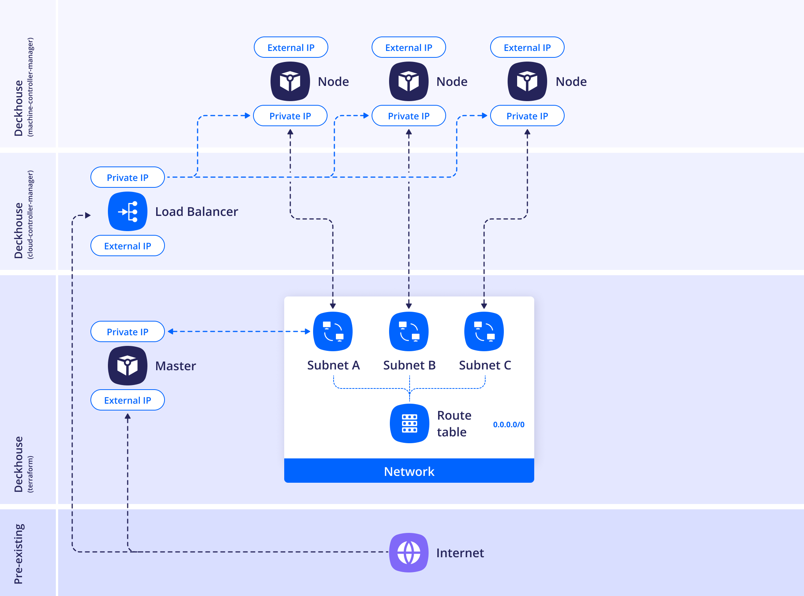
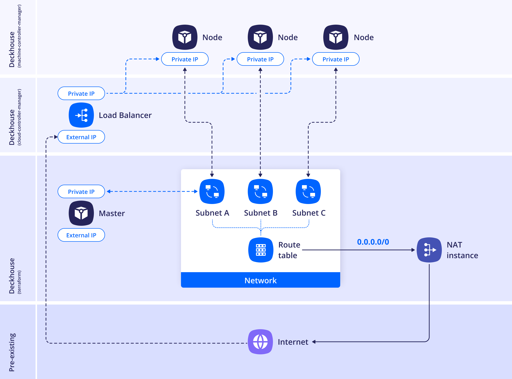

Three layouts are supported. The layout is specified by the [`layout`](/modules/cloud-provider-yandex/configuration.html#parameters-nodes-parameters-layout) parameter in the section of the `cloud-provider-yandex` module's ModuleConfig resource. Below is more information about each of them.

## Standard


In this placement strategy, nodes do not have public IP addresses allocated to them; they use NAT gateway service in Yandex Cloud to connect to the Internet. NAT Gateway uses random public IP addresses from [dedicated ranges](https://yandex.cloud/ru/docs/overview/concepts/public-ips#virtual-private-cloud). Because of this, it is impossible to whitelist the IP addresses of cloud resources located behind a specific NAT gateway on the side of other services.



Because nodes are created without public IP addresses in this layout, the master node must be accessible over SSH from the machine where `dhctl` is running: either directly over a private network or through a bastion host.
If the master node is not directly accessible, run the installation with the `--ssh-bastion-host`, `--ssh-bastion-user`, and, if needed, `--ssh-bastion-port` parameters.



<!--- Source: https://www.figma.com/design/T3ycFB7P6vZIL359UJAm7g/%D0%98%D0%BA%D0%BE%D0%BD%D0%BA%D0%B8-%D0%B8-%D1%81%D1%85%D0%B5%D0%BC%D1%8B?node-id=995-10422&t=IvETjbByf1MSQzcm-0 --->

Example of the layout configuration:

```yaml
apiVersion: deckhouse.io/v1alpha1
kind: ModuleConfig
metadata:
  name: cloud-provider-yandex
spec:
  version: 2
  enabled: true
  settings:
    provider:
      parameters:
        cloudID: <CLOUD_ID>
        folderID: <FOLDER_ID>
    nodes:
      parameters:
        layout: Standard
        sshPublicKey: <SSH_PUBLIC_KEY>
        nodeNetworkCIDR: 192.168.12.0/24
        existingNetworkID: <EXISTING_NETWORK_ID>
        zones:
          - ru-central1-a
          - ru-central1-b
          - ru-central1-d
        labels:
          billing: prod
        dhcpOptions:
          domainName: test.local
          domainNameServers:
            - <DNS_SERVER_1>
            - <DNS_SERVER_2>
```

## WithoutNAT

In this layout, NAT (of any kind) is not used, and each node is assigned a public IP.


The `cloud-provider-yandex` module does not assign security groups to the nodes, so in this layout the nodes are accessible from the outside without restrictions. To restrict the traffic, use the rules of the default group as described in ["Configuring security groups"](environment.html#configuring-security-groups).



<!--- Source: https://www.figma.com/design/T3ycFB7P6vZIL359UJAm7g/%D0%98%D0%BA%D0%BE%D0%BD%D0%BA%D0%B8-%D0%B8-%D1%81%D1%85%D0%B5%D0%BC%D1%8B?node-id=995-10557&t=IvETjbByf1MSQzcm-0 --->

Example of the layout configuration:

```yaml
apiVersion: deckhouse.io/v1alpha1
kind: ModuleConfig
metadata:
  name: cloud-provider-yandex
spec:
  version: 2
  enabled: true
  settings:
    provider:
      parameters:
        cloudID: <CLOUD_ID>
        folderID: <FOLDER_ID>
    nodes:
      parameters:
        layout: WithoutNAT
        sshPublicKey: <SSH_PUBLIC_KEY>
        nodeNetworkCIDR: 192.168.12.0/24
        existingNetworkID: <EXISTING_NETWORK_ID>
        zones:
          - ru-central1-a
          - ru-central1-b
          - ru-central1-d
        externalIPAddresses:
          master:
            - Auto
            - Auto
            - Auto
          worker:
            - <ZONE_A_EXTERNAL_IP_WORKER_1>
            - Auto
        externalSubnetIDs:
          master:
            - <ZONE_A_SUBNET_ID>
            - <ZONE_B_SUBNET_ID>
            - <ZONE_D_SUBNET_ID>
          worker:
            - <ZONE_A_SUBNET_ID>
            - <ZONE_B_SUBNET_ID>
        dhcpOptions:
          domainName: test.local
          domainNameServers:
            - <DNS_SERVER_1>
            - <DNS_SERVER_2>
```

## WithNATInstance

In this layout, a NAT instance is created in a separate subnet, and the route table of the zone subnets gets a `0.0.0.0/0` route with the NAT instance as the next hop.
The subnet is allocated to prevent routing loops and must not overlap with other networks used in the cluster.

To place the NAT instance in an existing subnet, use the `withNATInstance.internalSubnetID` parameter — the instance will be created in the zone corresponding to that subnet.

If you need to create a new subnet, specify the `withNATInstance.internalSubnetCIDR` parameter — the NAT instance will be deployed in it.

One of the parameters — `withNATInstance.internalSubnetID` or `withNATInstance.internalSubnetCIDR` — is required.

When the `withNATInstance.internalSubnetCIDR` parameter is specified, the NAT instance will be created in a single instance in zone `a`.

When the `withNATInstance.internalSubnetID` parameter is specified, the NAT instance will be created in a single instance in the zone specified in the designated network settings.

If the `withNATInstance.externalSubnetID` is provided in addition to previous ones, the NAT instance will be attached to it via secondary interface.


<!--- Source: https://www.figma.com/design/T3ycFB7P6vZIL359UJAm7g/%D0%98%D0%BA%D0%BE%D0%BD%D0%BA%D0%B8-%D0%B8-%D1%81%D1%85%D0%B5%D0%BC%D1%8B?node-id=995-10034&t=IvETjbByf1MSQzcm-0 --->

Example of the layout configuration:

```yaml
apiVersion: deckhouse.io/v1alpha1
kind: ModuleConfig
metadata:
  name: cloud-provider-yandex
spec:
  version: 2
  enabled: true
  settings:
    provider:
      parameters:
        cloudID: <CLOUD_ID>
        folderID: <FOLDER_ID>
    nodes:
      parameters:
        layout: WithNATInstance
        sshPublicKey: <SSH_PUBLIC_KEY>
        nodeNetworkCIDR: 192.168.12.0/24
        existingNetworkID: <EXISTING_NETWORK_ID>
        zones:
          - ru-central1-a
        withNATInstance:
          natInstanceExternalAddress: <NAT_INSTANCE_EXTERNAL_ADDRESS>
          internalSubnetID: <INTERNAL_SUBNET_ID>
          externalSubnetID: <EXTERNAL_SUBNET_ID>
        dhcpOptions:
          domainName: test.local
          domainNameServers:
            - <DNS_SERVER_1>
            - <DNS_SERVER_2>
```


In this example, master and worker nodes are created without public IP addresses and without additional external network interfaces. Outbound traffic from the cluster subnets goes through the NAT instance.

The NAT instance is not automatically used by the `dhctl` installer as a bastion host or jump host. To install the cluster, the master node must be accessible over SSH from the machine where `dhctl` is running: either directly or through a bastion host.

If the master node does not have a public IP address or is not directly accessible, run the installation with the `--ssh-bastion-host` and `--ssh-bastion-user` parameters.

If you need to connect directly to a master node using a public IP address, specify the [`externalIPAddresses`](/modules/cloud-provider-yandex/configuration.html#parameters-nodes-parameters-externalipaddresses) and [`externalSubnetIDs`](/modules/cloud-provider-yandex/configuration.html#parameters-nodes-parameters-externalsubnetids) parameters in the `nodes.parameters` section of the `cloud-provider-yandex` module's ModuleConfig resource. Note that the interface connected to the network specified in `externalSubnetIDs` will be used as the node's default gateway.

