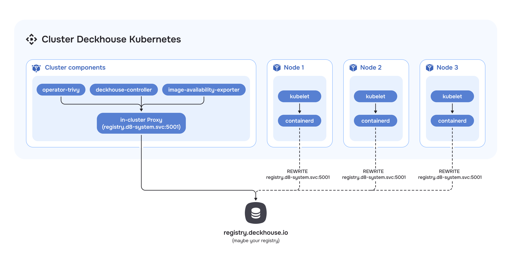
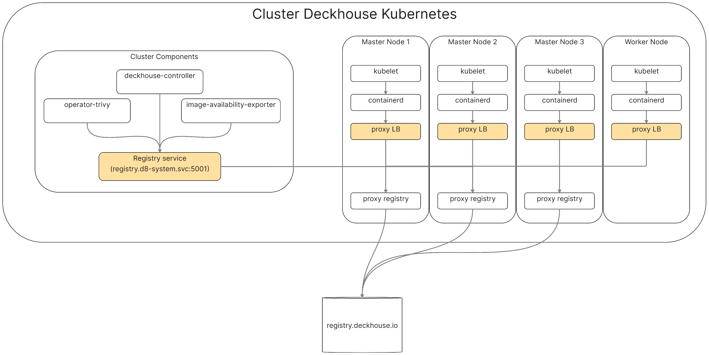
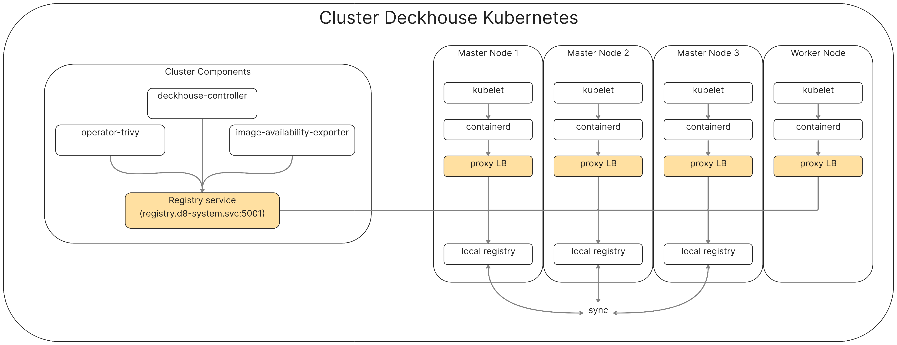

The module is used to manage the pull paths for container images of Deckhouse Platform (DP) components, and for images from additional registries (vendor or your own).

The current and previous implementations of the module are described below.


A cluster where the previous implementation of this module has never run uses the current one right away. A cluster where the previous implementation has run keeps using it until it is switched to the `Unmanaged` state, after which the migration completes on its own. The process is described in [How does the migration to the registry module work](faq.html#how-does-the-migration-to-the-registry-module-work).


## Current implementation

### Modes of operation

The module can run in one of the following modes (selected with the [`mode`](configuration.html#parameters-mode) parameter):

- `Unmanaged` (the default mode). In this mode the module does not manage the pull paths of DP components. With [`mode: Unmanaged`](configuration.html#parameters-mode) the cluster keeps pulling images from the registry it was installed with (set during cluster bootstrap in the [`deckhouse`](/products/kubernetes-platform/documentation/v1/reference/api/cr.html#initconfiguration-deckhouse) parameter in InitConfiguration). None of the module's components are created in this mode.
- `Managed`. In this mode the module manages the pull paths for container images. The cluster administrator hands the pull path to the module by setting the `mode: Managed` parameter.

  In this mode (when the module manages the pull paths) the following independent settings are used:

  - [`primary.upstream`](configuration.html#parameters-primary-upstream) — the registry images are pulled from. If not set, the cluster is considered air-gapped: the only source becomes the in-cluster cache, filled with the `d8 mirror push` command.
  - [`storage.cache`](configuration.html#parameters-storage-cache) — controls the in-cluster cache on the control-plane nodes. If set, a registry is deployed on the control-plane nodes. All nodes pull images from it, with the upstream staying a fallback path while the cache is being filled.

  Turning the cache on or off, changing the registry, changing credentials — each of these is an ordinary reconfiguration, possible at any time and in any order. Exactly one change has a condition attached: when the [upstream](configuration.html#parameters-primary-upstream) is removed to go air-gapped, the module waits until the in-cluster cache holds the whole expected image set and no workload in the `kube-system` and `d8-*` namespaces references the upstream any more — only then do images stop being pulled from the registry set in `primary.upstream`. Workloads in other namespaces are not counted: move the ones whose images reference the upstream address onto the in-cluster address before removing the upstream. While this is in progress, the [`D8RegistryAirGapTransitionHeld`](faq.html#what-do-the-registry-alerts-mean) alert fires. If the switch to the in-cluster cache happened right after the upstream was removed, every node could be left with nowhere to pull images from.

  The cache reclaims its own disk space. Nothing else ever removes data from it — every release adds a slice of the repository — so a sweep removes the slices of releases the cluster has already passed through, keeping the deployed release and the one before it. It runs on a schedule (nightly by default), once the cache holds a new image set — after a Deckhouse Platform update, or after a module is enabled or updated — and when the store refuses writes. A sweep does not interrupt serving, but it pauses filling the replica's store and can fail a `d8 mirror push` started during it, which is why it defaults to a nighttime hour. It can also be run right away with a [RegistryOperation](cr.html#registryoperation) object. For details, see the [`storage.garbageCollection`](configuration.html#parameters-storage-garbagecollection) parameter and the FAQ section [The cache keeps growing. What reclaims it](faq.html#the-cache-keeps-growing-what-reclaims-it).

The [`primary.upstream`](configuration.html#parameters-primary-upstream) and [`storage.cache`](configuration.html#parameters-storage-cache) parameters together cover every supported configuration:

| `primary.upstream` | `storage.cache` | What the cluster does |
|---|---|---|
| set | `false` | Nodes pull images directly from the upstream. Nothing is deployed on the control-plane nodes |
| set | `true` | The cache acts as a pass-through: filled from the upstream on demand and ahead of time |
| not set | `true` | Air-gapped. The cache is the only source, and `d8 mirror push` is the only way in |
| not set | `false` | The configuration is rejected: nodes would have nowhere to pull images from |

If the installation configuration specifies no registry at all (no registry parameters in [InitConfiguration](/products/kubernetes-platform/documentation/v1/reference/api/cr.html#initconfiguration-deckhouse), no `registry` section in the `deckhouse` ModuleConfig and no `registry` ModuleConfig), the installer creates the `registry` ModuleConfig with `mode: Managed` and `primary.upstream` pointing to the public CE registry `registry.deckhouse.io/deckhouse/ce`, and warns about it in its output. This applies only when the configuration contains a ClusterConfiguration and the container runtime is managed by Deckhouse Platform (`defaultCRI` is `Containerd` or `ContainerdV2`). In a managed Kubernetes cluster (without ClusterConfiguration) and with `defaultCRI: NotManaged` the installer does not create this ModuleConfig.

Under the same conditions the installer refuses a configuration in which the `registry` ModuleConfig sets `mode: Unmanaged` (or omits `mode`, which means the same) or `enabled: false` and no registry is specified anywhere else: the nodes would have nowhere to pull images from. Specify the registry nodes pull from directly in the [`deckhouse`](/products/kubernetes-platform/documentation/v1/reference/api/cr.html#initconfiguration-deckhouse) parameter of InitConfiguration (`imagesRepo` and `registryDockerCfg`), or set `mode: Managed` with `primary.upstream` in the `registry` ModuleConfig. A private or mirror registry the images were pushed to with `d8 mirror push` can serve as `primary.upstream`. To install an air-gapped cluster from an image bundle instead, set `enabled: true` and `mode: Managed` with `storage.cache: true` and `storage.source` and without `primary.upstream`, and pass the bundle to the installer with the `--img-bundle-path` flag.

The installer also refuses a `registry` ModuleConfig that specifies `primary` or `storage` without `mode: Managed`, as the module's schema does: in the default `Unmanaged` mode these settings would have no effect.

### Additional registries

`primary.upstream` is deliberately the only registry configurable through the module. It is used for the images of DP components. Additional registries (a vendor's, needed by some module, or your own) are declared as a separate [RegistryUpstream](cr.html#registryupstream) resource. Example:

```yaml
apiVersion: deckhouse.io/v1alpha1
kind: RegistryUpstream
metadata:
  name: virtualization-images
spec:
  match: images.virtualization.example.com
  upstream:
    host: vendor.example.com
    path: /virtualization
    auth:
      username: robot
      password: <PASSWORD>
```

This approach — declaring an additional registry as a separate resource — was chosen because a module or a user adding their own registry should not have to edit a ModuleConfig they don't own. Such registries are always transit: pulls are routed through the node agent so that credentials and CA certificates live in one place, but nothing from them is ever cached.

### Architecture

<!--- Source: mermaid code from docs/internal/MANAGED.md --->

#### The node agent

On every node of the cluster, an agent (registry-agent) is deployed as a static pod. The container runtime is pointed at it (`127.0.0.1:5001`, through containerd's `_default` fallback directory) and gets access to registries through it, passing the original registry name along in the request.

This achieves the following:

- **Node configuration is static.** Adding a registry, turning the in-cluster cache on, rotating credentials — none of this changes the configuration on any node, because the container runtime accesses registries through the agent.
- **Registry credentials stay out of the runtime's configuration files.** They are held by the agent and attached to every request.
- **Credentials are not stored in the module's resources.** A RegistryNode, a RegistryStorage, and the recorded effective upstream name a key in one Secret instead of carrying the credential itself. These are cluster-scoped resources, and the permission to read them is granted to every node, so a credential inside any of them would be readable through the API by every kubelet in the cluster. Each component's access is narrowed to that one Secret by name, and the credential it resolved is kept together with its own copy of the routing.
- **Pulling images works when the API server is unavailable.** The agent keeps a copy of its routing on disk and falls back to it, because the images it serves include the ones needed to repair a broken control plane. A node that could not reach the API server uses the routing it was installed with.

An unconfigured registry is proxied untouched, along with whatever credentials the request already carried — so an ordinary `imagePullSecret` for a third-party registry keeps working, with nothing needing to be declared for it.

#### The in-cluster cache

With [`storage.cache`](configuration.html#parameters-storage-cache) enabled, a registry runs on each control-plane node. It stores blobs (the files an image is made of) in the cache directory: `/var/lib/deckhouse/registry` when the master NodeGroup has `systemType: DeckhouseEngine`, `/opt/deckhouse/registry` otherwise. One control-plane node holds the lease and fills from the upstream; the others replicate data from the leading replica (the one holding the lease) ahead of time, so losing the leader does not mean filling from scratch. For details on how the leading replica is chosen, see [Leader election](#leader-election).

Agents reach a replica by the node's address, not by the service name `registry.d8-system.svc:5001`.
`registry.d8-system.svc:5001` is what every image reference in the cluster is built from, and what a request is matched against. But the agent runs in the host's network namespace, where the cluster DNS name does not resolve.

A replica serves on port `4281/TCP` of its control-plane node: the agents of every node connect to it, and so do the other replicas when they replicate. The publication endpoint behind the Ingress is port `4283/TCP` of the same nodes, reached from the nodes running the ingress controller. Both are in the 4200-4299 range and are listed in ["Network interaction of the platform components"](/products/kubernetes-platform/documentation/v1/reference/network_interaction.html). The `5001` in the service name is not the cache's port: on every node, `127.0.0.1:5001` is the agent.

That address (which agents use to reach a replica) takes effect in two steps, and the order matters. Nodes are given it as soon as
the module starts managing the pull path, through the same bashible rollout that installs the
agent. The image references of the platform's own components move only after every node's agent
has applied the configuration it was given: nothing resolves this address except the agent,
so re-rendering the cluster onto it any earlier would point every workload at something that
cannot be pulled yet. Until then, references keep naming the registry the cluster was
installed with — which is also where they return if the module is set to `Unmanaged` or
disabled. Whether this step has happened is visible from the presence of the ConfigMap
`registry-image-address` in `d8-system`.

The Deckhouse controller pulls through the same agent — at `127.0.0.1:5001` — its own release
channel and the module sources it owns. A different address, but the same agent: the
controller is a process and has to dial a connection, whereas an image reference is resolved by
the container runtime, which a drop-in redirects to the agent, so it can
name a service that nothing ever connects to. This is exactly what makes changing the registry a single
change: the configuration is edited in one place, the agents are reconfigured, and both what the nodes pull
and what the controller fetches follow — with no registry address for the
controller written down anywhere, and so none that could be left pointing at the old one.


Use a separate disk for the cache directory and for etcd data. Sharing one
disk degrades etcd while the cache is being filled.


##### The expected image set

The cache holds the expected image set: the images of the deployed DP release and of the previous one (for a rollback), the images of the modules the cluster runs, and the catalogue of modules the module sources offer. Updates the cluster lists as pending — of DP and of modules — are copied too, ahead of time: the replicas receive an update before it is deployed, in an air-gapped cluster as soon as `d8 mirror push` has put it into the store. An update the source does not hold yet does not hold the cache back; it is copied when it is deployed at the latest. The replicas copy only while one of them is short of the set or a pending update has appeared; after that, nothing is copied until the set changes again.

##### Leader election

Only a replica that already holds the whole expected image set can become the leader. The replica currently holding the lease steps aside once the expected set appears on another replica. A replica that does not hold the full expected image set cannot become the leader.

This rules out problems when the cluster goes air-gapped. If a replica without the full expected image set could become the leader, an air-gapped cluster could get stuck: a `d8 mirror push` request would land on it (because the ingress picked it), and:

- the other replicas could not replicate the expected image set (since the leader does not have it);
- the leader could not obtain the full image set either (since the cluster is air-gapped).

A replica whose node has been reported unreachable for a minute (about two minutes after the node stops responding) is not counted in the election, so the replicas that are left do not wait for a leader whose node is gone. A replica whose registry stops answering or whose disk stops accepting writes reports an error and hands the lease over to a replica that holds the full expected image set, if there is one; otherwise it keeps the lease and only reports the error.

After the leader's node fails, a new leader takes over in about a minute in an air-gapped cluster and in two to three minutes in a cluster with an upstream. While no replica holds the full expected image set yet, it can take up to about three and a half minutes, and two minutes more if the replica holding the most images does not take the lease. Nodes pull from the leader only, so until the new leader takes over and the nodes' configuration follows it, they pull from the upstream if one is configured; in an air-gapped cluster, pulls of images that are not already on the node wait for the new leader. The other replicas keep their data, so a new leader that holds the full expected image set fills nothing again.

While no replica holds the full expected image set, the replica that takes the lease may hold fewer images than another one, or none: the replica holding the most images is passed over if its node is unreachable or if it does not take the lease within two minutes. The new leader then fills what it lacks again, from the upstream, or, in an air-gapped cluster, from what is pushed again with `d8 mirror push`. It keeps the lease until some replica holds the full expected image set, even after the replica holding more images comes back.

A leader whose store has lost the expected image set, for example after the cache directory on its node was wiped, gives up the lease while another replica holds the whole set: it checks the deployed release and a sample of the set on its own disk about once a minute, and at startup. It reports `full: false` and `verifiedDigests: 0`, the replica that holds the set becomes the leader, and the former leader copies the set from it like any other replica. If no other replica holds the whole set, the leader keeps the lease, since it is still the one that fills the set, but reports `full: false` and `verifiedDigests: 0` all the same: `safeToDropUpstream` becomes `false`, and the leader fills the set again from the upstream (in an air-gapped cluster, counts its store again).

A replica whose store holds at most half as many manifests as its `verifiedDigests` (by `totalDigests`) stops reporting the set within about a minute and a half of the loss: the leader as described above, and a replica that does not hold the lease by reporting `full: false` and reading its store again. A smaller loss on a replica that does not hold the lease is reported no later than at its next periodic check of its store, every six hours by default. After the leader's syncer restarts, `safeToDropUpstream` stays `false` until the running syncer has read its store, normally at its first pass, within about two minutes, so a report left by the previous process cannot drop the upstream.

##### What protects the ports on control-plane nodes

The cache runs in the host network, so its ports are open on the address of every control-plane node, to anything that can reach that address: other nodes, pods, and hosts outside the cluster if the network lets them through. The module ships no host firewall policy for these ports (for example, Cilium host policies). Restricting who can reach a control-plane node at the network level is left to the cluster's own firewall. Each port protects itself as follows:

| Port | Purpose | Protection |
|---|---|---|
| `4281/TCP` | Reading: the agents of all nodes pull through it, the other replicas replicate from it. | TLS with the module's own certificate authority. Every request needs a token from the module's token service. The read credentials, which every node uses to get one, are on every node, so whoever has taken them from any node and can reach this port can pull everything the cache holds. The port does not accept writes, whatever the credentials: a push or a delete is refused, in an air-gapped cluster as well, where the port serves the store itself rather than a cache in front of an upstream. The store accepts writes only on `4283/TCP`, which requires a client certificate. |
| `4283/TCP` | Writing: `d8 mirror push` through the Ingress, and the replica's own filling, replication and garbage collection. | Mutual TLS. The connection is refused during the TLS handshake unless the client presents a certificate issued by the module's certificate authority to the ingress controller or to the cache's own pod. After that, the write credentials are checked. [`whitelistSourceRanges`](configuration.html#parameters-whitelistsourceranges) is applied by the Ingress only: the port does not filter by source address. A connection made directly to the port, or to the `registry-push` Service inside the cluster, without such a certificate fails at TLS. |
| `4285/TCP` | Metrics. | `kube-rbac-proxy`: a request needs a token of a subject allowed to get the `prometheus-metrics` subresource of the `registry-storage` StatefulSet in `d8-system`. The registry's own metrics and debug listeners are behind it, on the loopback. |

The ingress controller presents its certificate for any Ingress that names the `d8-system/registry-storage-ingress-client` secret, not only for the module's own. An ingress-nginx controller that lets an Ingress use a secret of another namespace (the `allow-cross-namespace-resources` option, enabled by default in controller versions before 1.12, 1.10 among them) therefore lets anyone who can create an Ingress and a Service in any namespace reach `4283/TCP` through them, outside `whitelistSourceRanges`. The write credentials are still checked on that path. To close it, turn `allow-cross-namespace-resources` off in the controller's configuration: the module's own Ingress is in `d8-system`, beside the secret, and keeps working.

A replica whose pod was created before `4281/TCP` started refusing writes still accepts a push on that port in an air-gapped cluster, until the pod is replaced. The `registry-storage` StatefulSet is updated with `OnDelete`: the module replaces the pods one at a time, each only while something else can serve the nodes in its place: another replica, the upstream, or, for the only replica of an air-gapped cache, its new images already held on its master node (see [How is the cache updated?](faq.html#how-is-the-cache-updated)). While a replacement waits, the module records an `UpdateBlocked` event on the `d8-system/registry-storage` StatefulSet.

Do not delete the pod to hurry this along. The new pod pulls its images from the store it is itself part of: deleted before they are on its node, the only replica of an air-gapped cache stays in `ImagePullBackOff`, and until it is back no node of the cluster can pull any image.

#### Air-gapped clusters

If no upstream is set in [`primary.upstream`](configuration.html#parameters-primary-upstream), the in-cluster cache is the only source of images, and
[`d8 mirror push`](/products/kubernetes-platform/documentation/v1/cli/d8/) is the only way into the registry. It arrives through a publication endpoint that requires
a client certificate from the ingress in addition to credentials: this is the one path that can replace an image, and
a leaked password must not be enough to use it. A push sent straight to a control-plane node, around the endpoint, is refused on either port of the cache. For what protects each port, including on a replica whose pod has not been replaced yet after an update, see [What protects the ports on control-plane nodes](#what-protects-the-ports-on-control-plane-nodes).

The endpoint is not limited to air-gapped clusters: it exists in every cluster that has image caching enabled, so that
images can be pushed into the store before the upstream is removed.

It also needs [`publicDomainTemplate`](/products/kubernetes-platform/documentation/v1/reference/api/global.html#parameters-modules-publicdomaintemplate) to be set and the `cert-manager` module to be enabled. If either is missing, an air-gapped cluster has no way to write into the store: `4281/TCP` refuses writes, and `4283/TCP` admits only the ingress controller and the cache itself. To bring images in, either set `publicDomainTemplate` and enable `cert-manager` (the endpoint appears on the next run of the module), or set [`primary.upstream`](configuration.html#parameters-primary-upstream) to a registry the cluster can reach that holds the images, let the cache fill from it, and remove the upstream again.

##### Installing from a bundle

An air-gapped cluster can also be installed straight from a bundle made with `d8 mirror pull`. To do so, set
`mode: Managed` in the `registry` ModuleConfig, enable [`storage.cache`](configuration.html#parameters-storage-cache)
with its [`storage.size`](configuration.html#parameters-storage-size), describe the bundle in
[`storage.source`](configuration.html#parameters-storage-source), set no
[`primary.upstream`](configuration.html#parameters-primary-upstream), and pass the bundle to the installer with
`--img-bundle-path`:

```yaml
spec:
  enabled: true
  settings:
    mode: Managed
    storage:
      cache: true
      size: 50Gi
      source:
        bundleRef: d8-mirror-bundle
        expectedDigests: 459
```

A temporary registry on the first control-plane node serves the bundle until the in-cluster cache starts on that node,
and the installer then hands the node over to the cache.

Installing from a bundle has the following limitations:

- In a cloud cluster, the `cloud-controller-manager` must be able to initialize the first control-plane node, which
  means the cloud API must be reachable from the cluster. Until the node loses the
  `node.cloudprovider.kubernetes.io/uninitialized` taint, the cache cannot be placed on it. The installer waits for
  that, and if it does not happen, it stops with an error naming the node and keeps the temporary registry, so that
  the node is not left with nothing to pull images from.
- A master NodeGroup with `systemType: DeckhouseEngine` does not support installing from a bundle: such a node runs none of
  the steps that set up the temporary registry. The installer refuses this combination before it creates any
  infrastructure. To install such a cluster without internet access, push the bundle with `d8 mirror push` into a
  registry inside your perimeter, and set `mode: Managed` with
  [`primary.upstream`](configuration.html#parameters-primary-upstream) pointing at that registry.

### Requirements for using the module

Before enabling the `registry` module to manage the pull paths for container images, make sure the cluster meets the following requirements:

- Nodes use containerd or containerd v2, set with the
  [`defaultCRI`](/products/kubernetes-platform/documentation/v1/reference/api/cr.html#clusterconfiguration-defaultcri)
  parameter in ClusterConfiguration.
- The cluster is fully managed by DP. The module does not work in Managed Kubernetes.
- The in-cluster cache uses disks on the control-plane nodes, in static and cloud clusters alike. In a cloud
  cluster that is the control-plane node's root disk unless another one is mounted at the cache directory
  (`/var/lib/deckhouse/registry` when the master NodeGroup has `systemType: DeckhouseEngine`, `/opt/deckhouse/registry`
  otherwise), so size that disk for [`storage.size`](configuration.html#parameters-storage-size) on top of what the node
  itself uses.

## The previous implementation

The previous implementation of the module is described below; it is planned to be phased out in the future. It is kept
because clusters are still running on it, and moving to the new configuration is work for the administrator that has to be
done before the cluster is upgraded, not after.


Prepare the cluster BEFORE upgrading to this release: the upgrade is blocked while the cluster uses the previous
implementation and the module is running in `Proxy` or `Local` mode, or in `Direct` mode without a configured
`registry` ModuleConfig.


Installing DP or upgrading to this release does not create any objects of the previous implementation. Switching the
previous implementation's modes is performed by the code of the previous release — so all preparation happens before moving to this release. Preparation has the following specifics:

- If the cluster uses the previous implementation of the `registry` module running in `Proxy` mode, it must be switched to `Unmanaged` mode.
- If a cluster with the previous implementation of the `registry` module is air-gapped (the module runs in `Local` mode), switching straight to `Unmanaged` mode does not work. Air-gapped clusters have a separate procedure, described in
[How do I migrate an air-gapped cluster from Local mode](faq.html#how-do-i-migrate-an-air-gapped-cluster-from-local-mode).
- If the cluster uses the previous implementation of the `registry` module running in `Direct` mode, no mode switch is needed — only this module's configuration, written
before the upgrade. Its objects are kept deliberately — the previous release marks them to survive
its own removal — and they keep serving the in-cluster address nodes pull through, until this module's agent has taken that address over. The procedure is described in
[migrating from Direct mode](faq.html#how-do-i-migrate-from-direct-mode).

In the previous implementation of the module, working with the registry is configured not through the module's own settings, but through the [`deckhouse` ModuleConfig](/modules/deckhouse/configuration.html#parameters-registry), and it works as a state machine with four modes:

- `Direct` — direct access to an external registry through the fixed address
  `registry.d8-system.svc:5001/system/deckhouse`. The fixed address is what keeps Deckhouse
  images from being re-downloaded, and components from restarting, when registry
  parameters change.
- `Proxy` — an internal caching proxy registry on the control-plane nodes, reachable at that same
  fixed address; it reduces the number of requests to the external registry.
- `Local` — a full local copy of the registry inside the cluster, for air-gapped environments.
- `Unmanaged` — no in-cluster registry; the cluster reaches the external one directly. Comes in
  a configurable form, managed through the `deckhouse` ModuleConfig, and a deprecated
  non-configurable form, set at
  [installation](/products/kubernetes-platform/documentation/v1/reference/api/cr.html#initconfiguration-deckhouse-imagesrepo).

Of the four previous-implementation modes listed above, two survive an upgrade to this release, for different reasons. `Unmanaged` is the
mode whose objects served nothing to begin with, so removing them takes nothing away, and the
handover happens on its own. `Direct` survives because the address its nodes pull images
through is also served by the `registry` module: the previous release marks the objects behind that address
so that they outlive its own removal, and they keep serving it until the
agent takes it over — meaning such a cluster needs this module's configuration rather than a mode
switch. Both paths are described in [how does the migration to the `registry` module work](faq.html#how-does-the-migration-to-the-registry-module-work). The two
implementations never manage a cluster at the same time: whichever one is active decides what gets
created at all, so there is no state where both configure the same node.

`Proxy` and `Local` modes leave nodes in a state that DP 1.78 and later cannot correctly account for or carry over. So the v1 implementation running in these modes is switched to `Unmanaged` first. That switch is only possible on DP 1.77 or earlier — that is, before upgrading to DP 1.78, which no longer contains the v1 implementation.

### Mode switching restrictions

The restrictions on switching modes in the previous implementation of the module are as follows:

- Changing registry parameters and switching modes is only available after the bootstrap phase
  is fully complete.
- For the first switch, migrate the user's registry configurations first — the procedure is described in the
  [FAQ](faq.html).
- Switching to the non-configurable `Unmanaged` mode is only available from `Unmanaged`.
- Switching between `Local` and `Proxy` is only possible through an intermediate `Direct` or
  `Unmanaged` mode. For example: `Local` → `Direct` → `Proxy`.
- Bootstrap in `Local` and `Proxy` modes is supported only on static clusters.

### Direct mode architecture

In `Direct` mode, requests to the registry are processed without intermediate caching. CRI requests
are redirected based on the containerd configuration. Components that access the registry
directly — `operator-trivy`, `image-availability-exporter`, `deckhouse-controller`, and others
— go through the in-cluster proxy on the control-plane nodes.

<!--- Source: mermaid code from docs/internal/DIRECT.md --->


### Proxy mode architecture


It is recommended to use separate disks for storing registry data
(`/opt/deckhouse/registry`) and etcd data. Using a single disk may lead to etcd performance
degradation while the registry is operating.


The caching proxy registry runs as static pods on the control-plane nodes and stores cached
data in `/opt/deckhouse/registry`. A load balancer sits in front of it on each node, and the containerd
configuration points at that load balancer. Components that access the registry
directly go through the caching proxy registry.

<!--- Source: mermaid code from docs/internal/PROXY.md --->


### Local mode architecture


It is recommended to use separate disks for storing registry data
(`/opt/deckhouse/registry`) and etcd data. Using a single disk may lead to etcd performance
degradation while the registry is operating.


`Local` mode keeps a full copy of the registry inside the cluster, synchronized between replicas
on the control-plane nodes and populated with the
[`d8`](/products/kubernetes-platform/documentation/v1/cli/d8/) tool using
`d8 mirror push`/`d8 mirror pull`. Otherwise it works the same way as the caching proxy.

<!--- Source: mermaid code from docs/internal/LOCAL.md --->

