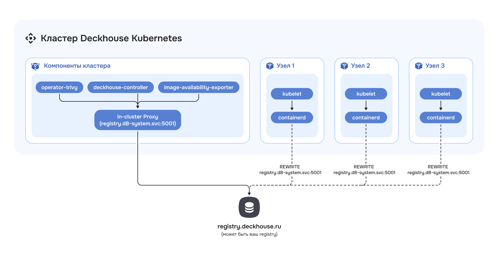
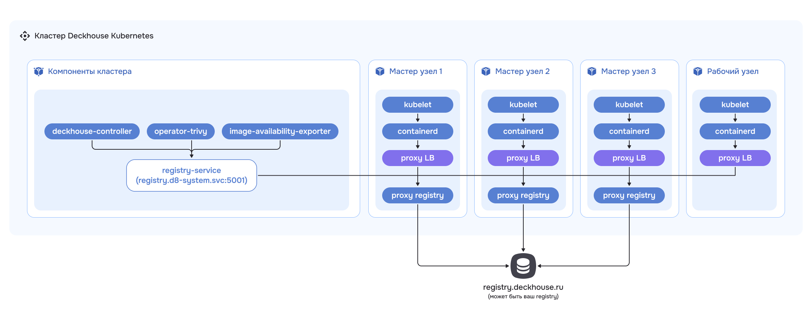
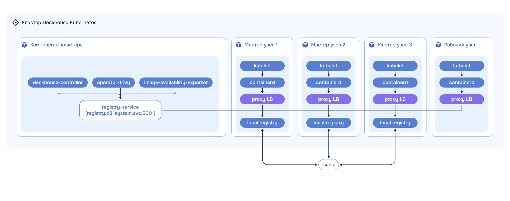

Модуль используется для управления путями загрузки образов контейнеров компонентов Deckhouse Platform (DP) и образов из дополнительных хранилищ (вендоров или ваших собственных).

Ниже описаны текущая реализация модуля и реализация v1, которая использовалась в DP до версии 1.77 включительно.


Кластер, в котором реализация v1 этого модуля никогда
не работала, сразу использует текущую. Кластер, в котором работала реализация v1, использует её до
перевода в состояние `Unmanaged`, после чего миграция завершается сама. Процесс описан в
разделе [«Как устроена миграция на модуль registry»](faq.html#как-устроена-миграция-на-модуль-registry).


## Текущая реализация

### Режимы работы

Модуль может работать в одном из следующих режимов (для выбора режима используется параметр [`mode`](configuration.html#parameters-mode)):

- `Unmanaged` (режим по умолчанию). В этом режиме модуль не управляет путями загрузки компонентов DP. При
[`mode: Unmanaged`](configuration.html#parameters-mode) кластер продолжает загружать образы из того хранилища образов контейнеров, с которым был установлен (задаётся при бутстрапе кластера в параметре [`deckhouse`](/products/kubernetes-platform/documentation/v1/reference/api/cr.html#initconfiguration-deckhouse) в InitConfiguration). Никакие компоненты модуля при этом не создаются.
- `Managed`. В этом режиме модуль управляет путями загрузки образов контейнеров. Управление путём загрузки передаётся модулю при включении администратором кластера параметра `mode: Managed`.

  При работе в этом режиме (когда модуль управляет путями загрузки) используются следующие независимые настройки:

  - [`primary.upstream`](configuration.html#parameters-primary-upstream) — хранилище образов контейнеров, откуда загружаются образы. Если параметр не задан, кластер считается изолированным (air-gap): единственным источником становится внутрикластерный кеш, который наполняется командой `d8 mirror push`.
  - [`storage.cache`](configuration.html#parameters-storage-cache) — управление внутрикластерным кешем на master-узлах. Если параметр указан, на master-узлах создаётся хранилище образов контейнеров. Все узлы получают образы из него, а upstream остаётся резервным путём, пока кеш наполняется.

  Включение и выключение кеша, смена хранилища образов контейнеров, смена учётных данных — каждое из этих действий обычная перенастройка, возможная в любой момент и в любом порядке. Условие привязано ровно к одному изменению: при удалении [upstream'а](configuration.html#parameters-primary-upstream) для перехода в air-gap модуль ожидает, пока во внутрикластерном кеше появится весь ожидаемый набор образов и в неймспейсах `kube-system` и `d8-*` не останется нагрузок, ссылающихся на upstream: только после этого образы перестанут загружаться из хранилища образов, которое было указано в `primary.upstream`. Нагрузки в других неймспейсах не учитываются: переведите те из них, образы которых ссылаются на адрес upstream, на адрес внутри кластера до того, как убрать upstream. При этом появляется алерт [`D8RegistryAirGapTransitionHeld`](faq.html#что-означают-алерты-модуля-registry).
  Если бы переключение на внутрикластерный кеш происходило сразу после удаления upstream'а, все узлы могли бы остаться без источника образов.

  Кеш освобождает свой диск сам. Никакие другие компоненты не удаляют из него данные ни при каких условиях — каждый релиз добавляет срез репозитория, — поэтому сборка мусора удаляет срезы релизов, которые кластер прошёл, сохраняя развёрнутый релиз и предыдущий. Она запускается по расписанию (по умолчанию ночью), когда кеш получил новый набор образов — после обновления Deckhouse Platform или после включения или обновления модуля, — и когда хранилище отказывает в записи.
  Во время сборки мусора загрузка образов из хранилища не блокируется. Но при этом приостанавливается наполнение хранилища реплики и загрузка образов в хранилище (`d8 mirror push`), начатая во время сборки мусора, может сорваться. Поэтому по умолчанию сборка мусора назначается на ночной час. Запустить её вручную можно объектом [RegistryOperation](cr.html#registryoperation). Подробности — в описании параметра [`storage.garbageCollection`](configuration.html#parameters-storage-garbagecollection) и в разделе FAQ [«Кеш растёт. Что его чистит»](faq.html#кеш-растёт-что-его-чистит).

Параметры [`primary.upstream`](configuration.html#parameters-primary-upstream) и [`storage.cache`](configuration.html#parameters-storage-cache) вместе покрывают все поддерживаемые конфигурации:

| `primary.upstream` | `storage.cache` | Что делает кластер |
|---|---|---|
| задан | `false` | Узлы загружают образы напрямую из upstream'а. На master-узлах ничего не разворачивается |
| задан | `true` | Кеш на проход: наполняется из upstream'а по запросу и заранее |
| не задан | `true` | Air-gap. Кеш — единственный источник, путь внутрь — `d8 mirror push` |
| не задан | `false` | Конфигурация отвергается: узлам было бы неоткуда загружать образы |

Если в конфигурации установки хранилище образов контейнеров не задано нигде (нет параметров хранилища в [InitConfiguration](/products/kubernetes-platform/documentation/v1/reference/api/cr.html#initconfiguration-deckhouse), нет секции `registry` в ModuleConfig `deckhouse` и нет ModuleConfig `registry`), установщик создаёт ModuleConfig `registry` с `mode: Managed` и `primary.upstream`, указывающим на публичное хранилище CE `registry.deckhouse.io/deckhouse/ce`, и предупреждает об этом в своём выводе. Это происходит, только если в конфигурации есть ClusterConfiguration и среда исполнения контейнеров управляется Deckhouse Platform (`defaultCRI` — `Containerd` или `ContainerdV2`). В управляемом кластере Kubernetes (без ClusterConfiguration) и при `defaultCRI: NotManaged` установщик этот ModuleConfig не создаёт.

При тех же условиях установщик отклоняет конфигурацию, в которой ModuleConfig `registry` задаёт `mode: Unmanaged` (или не задаёт `mode`, что означает то же самое) или `enabled: false`, а хранилище не указано больше нигде: узлам неоткуда было бы загружать образы. Укажите хранилище, из которого узлы загружают образы напрямую, в параметре [`deckhouse`](/products/kubernetes-platform/documentation/v1/reference/api/cr.html#initconfiguration-deckhouse) InitConfiguration (`imagesRepo` и `registryDockerCfg`) или задайте в ModuleConfig `registry` `mode: Managed` с `primary.upstream`. В качестве `primary.upstream` подойдёт и приватное хранилище или зеркало, в которое образы загружены командой `d8 mirror push`. Чтобы вместо этого установить изолированный кластер из бандла образов, задайте `enabled: true` и `mode: Managed` с `storage.cache: true` и `storage.source` без `primary.upstream` и передайте бандл установщику флагом `--img-bundle-path`.

Установщик также отклоняет ModuleConfig `registry`, в котором `primary` или `storage` заданы без `mode: Managed`, как это делает схема модуля: в режиме `Unmanaged`, который действует по умолчанию, эти настройки ни на что бы не влияли.

### Дополнительные хранилища образов контейнеров

`primary.upstream` намеренно единственное хранилище образов контейнеров, настраиваемое в конфигурации модуля. Оно используется для образов компонентов DP. Дополнительные хранилища образов контейнеров (вендоров, нужные какому-то модулю, или ваши собственные) объявляются отдельным ресурсом [RegistryUpstream](cr.html#registryupstream). Пример:

```yaml
apiVersion: deckhouse.io/v1alpha1
kind: RegistryUpstream
metadata:
  name: virtualization-images
spec:
  match: images.virtualization.example.com
  upstream:
    host: vendor.example.com
    path: /virtualization
    auth:
      username: robot
      password: <PASSWORD>
```

Подход с объявлением дополнительного хранилища образов выбран из-за того, что модуль или пользователь, добавляющий своё хранилище образов, не должен для этого править ModuleConfig, которым он не владеет. Такие хранилища образов всегда транзитные: они маршрутизируются через агент на узле, чтобы учётные данные и удостоверяющие центры лежали в одном месте, но никогда не кешируются.

### Архитектура

<!--- Source: mermaid code from docs/internal/MANAGED.md --->

#### Агент на узле

На каждом узле кластера в виде статического пода разворачивается агент (registry-agent). Container runtime направляется на него (`127.0.0.1:5001`, через каталог-фолбэк `_default` в containerd) и получает через него доступ к хранилищам образов контейнеров, передавая в запросе исходное имя хранилища.

Благодаря этому достигается следующее:

- **Конфигурация узла статична.** Добавление хранилища образов контейнеров, включение внутрикластерного кеша, смена учётных данных — ничего из этого не приводит к смене конфигурации ни на одном узле, т.к. container runtime обращается к хранилищу образов через агента.
- **Учётные данные хранилища образов контейнеров не попадают в конфигурационные файлы runtime.** Они хранятся на агенте и
  подставляются в каждый запрос.
- **Учётные данные не хранятся в ресурсах модуля.** RegistryNode, RegistryStorage и запись о действующем upstream указывают ключ в одном секрете, а не содержат сам ключ доступа. Это ресурсы кластерного уровня, и право читать их выдано каждому узлу, поэтому ключ внутри любого из них был бы доступен через API kubelet'у всего кластера. Доступ каждого компонента сужен до этого одного секрета по имени, а разрешённый ключ компонент хранит вместе со своей копией маршрутизации.
- **Загрузка образов работает, когда API-сервер недоступен.** Агент хранит копию своей маршрутизации на диске и переходит на неё, потому что среди образов, которые он отдаёт, есть и те, что нужны для восстановления сломанного control plane. Узел, который не смог получить доступ к API, использует маршрутизацию, с которой был установлен.

Ненастроенное хранилище образов контейнеров проксируется без изменений, вместе с теми учётными данными, которые уже были в запросе, — поэтому обычный `imagePullSecret` для стороннего хранилища продолжает работать, и объявлять для этого ничего не нужно.

#### Внутрикластерный кеш

При включённом [`storage.cache`](configuration.html#parameters-storage-cache) на каждом master-узле работает хранилище образов. Оно хранит блобы (файлы, из которых состоит образ) в директории кеша: `/var/lib/deckhouse/registry`, если у NodeGroup master-узлов `systemType: DeckhouseEngine`, иначе `/opt/deckhouse/registry`. Один master-узел держит lease и наполняется из upstream'а. Остальные реплицируют данные из главной реплики (которая держит lease) заранее — чтобы потеря лидера не означала наполнение с нуля. Подробнее о выборе главной реплики — в разделе [«Механизм выбора главной реплики»](#механизм-выбора-главной-реплики).

Агенты обращаются к реплике по адресу узла, а не по имени сервиса `registry.d8-system.svc:5001`.
`registry.d8-system.svc:5001` — это то, из чего строится каждая ссылка на образ в кластере, и то, с чем сопоставляется запрос. Но агент работает в сетевом пространстве хоста, где имя cluster DNS не разрешается.

Реплика слушает порт `4281/TCP` своего master-узла: к нему подключаются агенты всех узлов, а при репликации — и остальные реплики. Эндпоинт публикации за Ingress — порт `4283/TCP` тех же узлов, к нему подключаются узлы, на которых работает ingress-контроллер. Оба порта входят в диапазон 4200–4299 и перечислены в разделе [«Сетевое взаимодействие компонентов платформы»](/products/kubernetes-platform/documentation/v1/reference/network_interaction.html). `5001` в имени сервиса — не порт кеша: на каждом узле `127.0.0.1:5001` занимает агент.

Этот адрес (по которому агенты обращаются к реплике) вступает в силу в два шага, и порядок здесь важен. Узлы получают его сразу, как
только модуль начинает управлять путём загрузки образов, — тем же прогоном bashible, который
устанавливает агента. Ссылки на образы собственных компонентов платформы переезжают только
после того, как агент на каждом узле применил выданную ему конфигурацию: на узле этот адрес
не разрешается ничем, кроме агента, поэтому перерендер кластера на него раньше указал бы каждой
нагрузке на то, что пока невозможно загрузить. До этого ссылки продолжают указывать на
хранилище образов, с которого кластер был установлен, — туда же они возвращаются, если модулю задать
`Unmanaged` или выключить его. Произошёл ли этот шаг, видно по наличию ConfigMap
`registry-image-address` в `d8-system`.

Через того же агента загружает образы и сам deckhouse-controller — по адресу `127.0.0.1:5001`,
свой канал обновлений и принадлежащие ему источники модулей. Адрес другой, а агент тот же:
контроллер — это процесс, и ему нужно установить соединение, тогда как ссылка на образ
разрешается container runtime, которого drop-in перенаправляет на агента, поэтому она может
называть сервис, к которому никто не подключается. Именно это делает смену хранилища образов контейнеров одним
изменением: конфигурация правится в одном месте, агенты переконфигурируются, и за ними следуют
и то, что загружают узлы, и то, что загружает контроллер, — при этом ни один адрес хранилища образов контейнеров для
контроллера нигде не записан, а значит и не может остаться указывающим на прежний.


Используйте отдельные диски для директории кеша и для данных etcd.
Общий диск приводит к деградации etcd во время наполнения кеша.


##### Ожидаемый набор образов

Кеш хранит ожидаемый набор образов: образы развёрнутого релиза DP и предыдущего релиза (для отката), образы модулей, которые работают в кластере, и каталог модулей, которые предлагают источники модулей. Обновления, которые кластер видит ожидающими развёртывания, — DP и модулей — тоже копируются, заранее: реплики получают обновление до его развёртывания, в изолированном кластере — сразу после того, как `d8 mirror push` поместил его в хранилище. Обновление, которого ещё нет в источнике, не задерживает кеш: оно будет скопировано не позднее, чем при развёртывании. Реплики копируют образы, только пока хотя бы одной из них не хватает набора или появилось ожидающее обновление; после этого ничего не копируется до следующего изменения набора.

##### Репликация

Остальные реплики копируют образы с порта чтения лидера — того же, через который загружают образы узлы. Реплика записывает только в своё хранилище, через свой порт записи, и ни одна реплика не использует порт записи другой, поэтому для репликации между master-узлами нужен только порт чтения. При этом порт записи лидера должен быть доступен с узлов, на которых работает Ingress-контроллер: эндпоинт публикации передаёт на него загрузки `d8 mirror push` (см. [Изолированные кластеры](#изолированные-кластеры)). Что реплика может получить с порта чтения лидера, зависит от того, задан ли upstream:

- Если upstream задан, порт чтения лидера работает как pull-through-кеш для образов из upstream'а: образ, которого у лидера ещё нет, лидер скачивает из upstream'а, отдаёт реплике и сохраняет у себя. Поэтому реплика не ждёт, пока лидер закончит наполнение. Образ, которого после прохода репликации всё ещё не хватает (`pending_on_the_leader` в строке `the replication finished` в логе syncer'а), ещё не получил сам лидер: например, модуль из другого источника модулей, который лидер копирует из хранилища образов этого источника, а не через upstream, или образ, который upstream в тот момент не смог отдать. Его заберёт один из следующих проходов.
- Если upstream не задан, лидер отдаёт только то, что хранит сам. Образ, которого нет у лидера, отсутствует в источнике: `d8 mirror push` его ещё не загрузил.

Скорость ограничена только у заблаговременного копирования ожидающих обновлений: оно читает из источника не быстрее 16 МиБ/с, чтобы не отнимать процессор master-узла у etcd и API-сервера. Наполнение лидера ожидаемым набором и репликация этого набора не ограничены: пока набора нет в хранилище, узлы загружают образы через upstream, а реплика без набора не может подстраховать кластер (а в изолированном кластере подстраховать больше нечему). Реплики копируют независимо друг от друга, поэтому все они читают с лидера одновременно, каждая по нескольку слоёв сразу, и всё это — вдобавок к загрузке образов узлами. В ModuleConfig ничего из этого не настраивается.

##### Механизм выбора главной реплики

Лидер наполняет хранилище и служит источником, из которого копируют остальные реплики, поэтому lease распределяется не обычными выборами:

- Если у какой-то реплики есть весь ожидаемый набор образов, лидер, который не может собрать набор сам, уступает ей. Лидер не может собрать набор сам, если upstream не задан, если его последний проход завершился ошибкой, если его хранилище отказывает в записи или если он перестал продлевать lease.
- Лидер, который ещё собирает набор из upstream'а, сохраняет lease, даже если другая реплика закончила раньше: она копирует с лидера, и передача lease ничего бы не дала.
- Пока весь набор не собран ни на одной реплике (например, в новом кластере), lease не переходит: каждый переход начинал бы наполнение заново на другой реплике. Если лидера нет вообще, lease получает реплика с наибольшим числом проверенных образов; при равенстве выбор делается по имени узла. Реплика, чьё хранилище образов не отвечает или чей диск не принимает запись, не рассматривается, как и реплика, хранилищу которой не хватает места, пока место есть у другой реплики. Ошибка прохода сама по себе реплику не исключает: то, что она хранит, всё равно считается по её хранилищу.

Таким образом, лидером может быть и неполная реплика — пока полной нет ни одной или пока она наполняется из upstream'а. Поля статуса, по которым это видно, описаны в [FAQ](faq.html#как-посмотреть-состояние-внутрикластерного-кеша).

Правило, по которому лидерство переходит к полной реплике, важнее всего в изолированном кластере. Там лидер получает образы только через `d8 mirror push`, который всегда попадает на лидера, а остальные реплики копируют только то, что есть у лидера. Неполный лидер рядом с полной репликой (например, лидер, чьё хранилище было потеряно) не смог бы собрать набор, у остальных реплик были бы те же пробелы, а образы с полной реплики не попали бы никуда.

Реплика на узле, который уже минуту числится недоступным (примерно через две минуты после того, как узел перестал отвечать), в выборах не учитывается, поэтому оставшиеся реплики не ждут лидера, чей узел пропал. Реплика, чьё хранилище образов перестало отвечать или чей диск перестал принимать запись, сообщает об ошибке и передаёт lease реплике с полным ожидаемым набором образов, если такая есть; если нет, она остаётся лидером и только сообщает об ошибке.

После отказа узла лидера новый лидер появляется примерно через минуту в изолированном кластере и через две–три минуты в кластере с upstream. Пока ни у одной реплики нет полного ожидаемого набора образов, это может занять примерно до трёх с половиной минут, и ещё две минуты, если реплика с наибольшим числом образов не берёт lease. Узлы скачивают образы только с лидера, поэтому, пока новый лидер не занял его место и конфигурация узлов не переключилась на него, они скачивают образы из upstream, если он задан. В изолированном кластере скачивание образов, которых ещё нет на узле, ждёт нового лидера. Остальные реплики сохраняют свои данные, поэтому новый лидер с полным ожидаемым набором образов ничего не наполняет заново.

Пока ни у одной реплики нет полного ожидаемого набора образов, lease может взять реплика, у которой образов меньше, чем у другой, или нет совсем: реплика с наибольшим числом образов пропускается, если её узел недоступен или если она не взяла lease за две минуты. Тогда новый лидер заново наполняется недостающими образами из upstream, а в изолированном кластере — тем, что снова загружено через `d8 mirror push`. Он сохраняет lease, пока у какой-либо реплики не появится полный ожидаемый набор образов, даже если вернётся реплика, у которой образов больше.

Лидер, чьё хранилище потеряло ожидаемый набор образов (например, после очистки каталога кеша на его узле), отдаёт lease, если у другой реплики есть весь набор: он проверяет развёрнутый релиз и выборку набора на своём диске примерно раз в минуту и при запуске. Лидер сообщает `full: false` и `verifiedDigests: 0`, лидером становится реплика с полным набором, а бывший лидер копирует набор с неё, как любая другая реплика. Если ни у одной другой реплики нет всего набора, лидер сохраняет lease, потому что наполнять набор по-прежнему ему, но всё равно сообщает `full: false` и `verifiedDigests: 0`: `safeToDropUpstream` становится `false`, а лидер заново наполняет набор из upstream (в изолированном кластере — снова пересчитывает своё хранилище).

Реплика, в хранилище которой манифестов не больше половины её `verifiedDigests` (по `totalDigests`), в течение примерно полутора минут после потери перестаёт сообщать о полном наборе: лидер — как описано выше, а реплика, которая не держит lease, сообщает `full: false` и заново читает своё хранилище. О меньшей потере реплика, которая не держит lease, сообщает не позже следующей периодической проверки своего хранилища, по умолчанию раз в шесть часов. После перезапуска синкера лидера `safeToDropUpstream` остаётся `false`, пока работающий синкер не прочитает своё хранилище (обычно на первом проходе, примерно в течение двух минут), поэтому отчёт, оставленный предыдущим процессом, не может снять upstream.

##### Чем защищены порты на master-узлах

Кеш работает в сети хоста, поэтому его порты открыты на адресе каждого master-узла для всех, кто может до этого адреса дойти: для других узлов, подов и, если сеть пропускает, для хостов вне кластера. Политик межсетевого экрана узла для этих портов (например, host-политик Cilium) модуль не поставляет. Ограничивать сетевой доступ к master-узлам должен межсетевой экран самого кластера. Каждый порт защищён так:

| Порт | Назначение | Защита |
|---|---|---|
| `4281/TCP` | Чтение: через него загружают образы агенты всех узлов, с него реплицируют остальные реплики. | TLS с собственным удостоверяющим центром модуля. Каждому запросу нужен токен от сервиса токенов модуля. Учётные данные для чтения, по которым его получает каждый узел, есть на каждом узле, поэтому тот, кто получил их с любого узла и может дойти до этого порта, может загрузить всё, что хранит кеш. Запись порт не принимает ни с какими учётными данными: push или удаление отклоняются, в том числе в изолированном кластере, где за портом стоит само хранилище, а не кеш перед upstream. Запись в хранилище принимается только на `4283/TCP`, который требует клиентский сертификат. |
| `4283/TCP` | Запись: `d8 mirror push` через Ingress, а также наполнение, репликация и сборка мусора самой реплики. | Взаимная TLS-аутентификация. Соединение отклоняется ещё при установке TLS, если клиент не предъявил сертификат, который удостоверяющий центр модуля выпустил ingress-контроллеру или поду самого кеша. После этого проверяются учётные данные для записи. [`whitelistSourceRanges`](configuration.html#parameters-whitelistsourceranges) применяется только на Ingress: сам порт по адресу источника не фильтрует. Соединение напрямую с портом или с Service `registry-push` внутри кластера без такого сертификата не проходит установку TLS. |
| `4285/TCP` | Метрики. | `kube-rbac-proxy`: запросу нужен токен субъекта, которому разрешено получать подресурс `prometheus-metrics` StatefulSet `registry-storage` в `d8-system`. Собственные метрики и отладочный слушатель хранилища находятся за ним, на loopback. |

Ingress-контроллер предъявляет свой сертификат для любого Ingress, который ссылается на секрет `d8-system/registry-storage-ingress-client`, а не только для Ingress модуля. Если ingress-nginx разрешает Ingress использовать секрет из другого пространства имён (параметр `allow-cross-namespace-resources`, по умолчанию включён в версиях контроллера до 1.12, в том числе в 1.10), то любой, кто может создать Ingress и Service в каком-либо пространстве имён, может через них дойти до `4283/TCP` в обход `whitelistSourceRanges`. Учётные данные для записи на этом пути всё равно проверяются. Чтобы закрыть этот путь, выключите `allow-cross-namespace-resources` в конфигурации контроллера: Ingress модуля находится в `d8-system`, рядом с секретом, и продолжит работать.

Реплика, чей под создан до того, как `4281/TCP` перестал принимать запись, в изолированном кластере принимает push на этот порт, пока под не будет заменён. StatefulSet `registry-storage` обновляется со стратегией `OnDelete`: модуль заменяет поды по одному, и каждый — только когда вместо него отдавать образы узлам может кто-то другой: другая реплика, upstream или, для единственной реплики кеша в изолированном кластере, её новые образы, уже загруженные на её master-узел (см. [Как обновляется кеш?](faq.html#как-обновляется-кеш)). Пока замена ждёт, модуль создаёт событие `UpdateBlocked` на StatefulSet `d8-system/registry-storage`.

Не удаляйте под, чтобы ускорить обновление. Новый под загружает свои образы из хранилища, частью которого сам является: если удалить его раньше, чем они окажутся на узле, единственная реплика кеша в изолированном кластере останется в `ImagePullBackOff`, и, пока она не поднимется, ни один узел кластера не сможет загрузить ни одного образа.

#### Изолированные кластеры

Если в параметре [`primary.upstream`](configuration.html#parameters-primary-upstream) не задан upstream, внутрикластерный кеш — единственный источник образов, а попасть в него образы могут только через
[`d8 mirror push`](/products/kubernetes-platform/documentation/v1/cli/d8/).

`d8 mirror push` записывает образы через эндпоинт публикации — Ingress `registry-push` в неймспейсе `d8-system` на домене `registry`, построенном по [publicDomainTemplate](/products/kubernetes-platform/documentation/v1/reference/api/global.html#parameters-modules-publicdomaintemplate).
Эндпоинт существует всегда, когда включён кеш, задан `publicDomainTemplate` и включён модуль `cert-manager`, в том числе пока задан upstream, — чтобы образы можно было загрузить до того, как upstream будет удалён.
Загрузка всегда попадает на лидера; пока лидера нет, она отклоняется.

Это единственный путь, по которому образ можно заменить, поэтому для загрузки нужны и учётные данные с правом записи — учётная запись из секрета `registry-storage-push` в `d8-system`, предназначенная для `d8 mirror push`, — и клиентский сертификат, который ingress предъявляет хранилищу: одного утёкшего пароля недостаточно.
По этому же сертификату хранилище определяет, что переданному ingress'ом адресу клиента можно доверять. Чтобы ограничить, кто может обратиться к эндпоинту, задайте [`whitelistSourceRanges`](configuration.html#parameters-whitelistsourceranges).
Push, отправленный напрямую на master-узел в обход эндпоинта, отклоняется на обоих портах кеша. Чем защищён каждый порт, в том числе на реплике, чей под ещё не заменён после обновления, описано в разделе [«Чем защищены порты на master-узлах»](#чем-защищены-порты-на-master-узлах).

Если параметр `publicDomainTemplate` не задан или модуль `cert-manager` выключен, записать в хранилище изолированного кластера нечем: `4281/TCP` запись отклоняет, а `4283/TCP` принимает только ingress-контроллер и сам кеш. Чтобы поместить образы в кластер, либо задайте `publicDomainTemplate` и включите `cert-manager` (эндпоинт появится при следующем запуске модуля), либо укажите в [`primary.upstream`](configuration.html#parameters-primary-upstream) доступный из кластера registry, в котором есть нужные образы, дождитесь, пока кеш наполнится из него, и снова уберите upstream.

##### Установка из бандла

Изолированный кластер можно установить и сразу из бандла, подготовленного командой `d8 mirror pull`. Для этого в
ModuleConfig `registry` задайте `mode: Managed`, включите [`storage.cache`](configuration.html#parameters-storage-cache)
и укажите его размер в [`storage.size`](configuration.html#parameters-storage-size), опишите бандл в
[`storage.source`](configuration.html#parameters-storage-source), не задавайте
[`primary.upstream`](configuration.html#parameters-primary-upstream) и передайте бандл установщику в параметре
`--img-bundle-path`:

```yaml
spec:
  enabled: true
  settings:
    mode: Managed
    storage:
      cache: true
      size: 50Gi
      source:
        bundleRef: d8-mirror-bundle
        expectedDigests: 459
```

Пока на первом control-plane-узле не запустится внутрикластерный кеш, бандл раздаёт временное хранилище образов на
этом узле. Затем установщик передаёт узел кешу.

У установки из бандла есть ограничения:

- В облачном кластере `cloud-controller-manager` должен инициализировать первый control-plane-узел, поэтому API облака
  должен быть доступен из кластера. Пока с узла не снят taint `node.cloudprovider.kubernetes.io/uninitialized`, кеш на
  него не размещается. Установщик ждёт снятия taint. Если этого не происходит, он завершается с ошибкой, в которой
  указан узел, и оставляет временное хранилище образов, чтобы узлу было откуда загружать образы.
- Для master NodeGroup с `systemType: DeckhouseEngine` установка из бандла не поддерживается: на таком узле не выполняются
  шаги, которые разворачивают временное хранилище образов. Установщик отказывает в такой конфигурации до создания
  инфраструктуры. Чтобы установить такой кластер без доступа в интернет, загрузите бандл командой `d8 mirror push` в
  хранилище образов внутри своего периметра и задайте `mode: Managed` с
  [`primary.upstream`](configuration.html#parameters-primary-upstream), указывающим на это хранилище.

### Требования к использованию модуля

Перед включением управления путями загрузки образов контейнеров с помощью модуля `registry` проверьте, что кластер соответствует следующим требованиям:

- На узлах используется containerd или containerd v2 — задаётся параметром
  [`defaultCRI`](/products/kubernetes-platform/documentation/v1/reference/api/cr.html#clusterconfiguration-defaultcri)
  в ClusterConfiguration.
- Кластер полностью управляется DP. В Managed Kubernetes модуль не работает.
- Внутрикластерный кеш использует диски master-узлов — как в статических, так и в облачных кластерах. В облачном
  кластере это корневой диск master-узла, если в директорию кеша не смонтирован отдельный
  (`/var/lib/deckhouse/registry`, если у NodeGroup master-узлов `systemType: DeckhouseEngine`, иначе
  `/opt/deckhouse/registry`). На этом диске должны поместиться [`storage.size`](configuration.html#parameters-storage-size)
  и резерв, который хранилище оставляет свободным для узла, сверх того, что занимает сам узел. Задавайте `storage.size`
  под три релиза набора образов вместе с модулями и каталогом модулей; подробнее — в разделе
  [«Что происходит, когда хранилище кеша заполнено?»](faq.html#что-происходит-когда-хранилище-кеша-заполнено).

## Реализация v1

Далее описана реализация модуля v1, которая использовалась в DP до версии 1.77 включительно. В DP 1.78 её уже нет, а описание сохранено, потому что на
ней всё ещё работают кластеры, и переход на новую конфигурацию — работа администратора, которую надо
выполнить до обновления кластера, а не после.


Подготовьте кластер ДО обновления на DP 1.78: обновление заблокировано, пока в кластере используется реализация
v1 и модуль работает в режиме `Proxy`, `Local`, либо в режиме `Direct` без настроенного
ModuleConfig `registry`.


При установке DP 1.78 и более новых версий или обновлении на них объекты реализации v1 не создаются. Новую установку
с режимом `Proxy` или `Local` в ModuleConfig `deckhouse` установщик отклоняет: вместо этого настройте этот модуль.
Режимы реализации v1
переключает только код DP 1.77 и более ранних версий — поэтому вся подготовка выполняется до обновления на DP 1.78. Подготовка имеет следующие особенности:

- Если в кластере используется модуль `registry` в реализации v1, работающий в режиме `Proxy`, необходимо перевести его в режим `Unmanaged`.
- Если кластер с модулем `registry` в реализации v1 изолирован (модуль работает в режиме `Local`), перевод сразу на режим `Unmanaged` не подходит. Для изолированных кластеров есть отдельная процедура, описанная в разделе
[«Как мигрировать изолированный кластер из режима Local»](faq.html#как-мигрировать-изолированный-кластер-из-режима-local).
- Если в кластере используется модуль `registry` в реализации v1, работающий в режиме `Direct`, переключение режима не нужно — только конфигурация этого модуля, записанная
до обновления. Его объекты сохраняются намеренно — DP 1.77 помечает их так, чтобы они
пережили удаление реализации v1, — и продолжают обслуживать внутрикластерный адрес, через
который загружают образы узлы, пока этот адрес не примет агент модуля. Порядок действий описан в
разделе [«Как мигрировать из режима Direct»](faq.html#как-мигрировать-из-режима-direct).

В реализации v1 работа с хранилищем образов контейнеров настраивается не через настройки самого модуля, а через [ModuleConfig `deckhouse`](/modules/deckhouse/configuration.html#parameters-registry), и работает как конечный автомат с четырьмя режимами:

- `Direct` — прямой доступ к внешнему хранилищу образов контейнеров по фиксированному адресу
  `registry.d8-system.svc:5001/system/deckhouse`. Фиксированный адрес — это то, что позволяет
  избежать повторного скачивания образов Deckhouse и перезапуска компонентов при смене
  параметров хранилища образов контейнеров.
- `Proxy` — внутренний кеширующий прокси-registry на master-узлах, доступный по тому же
  фиксированному адресу; сокращает количество запросов к внешнему хранилищу образов контейнеров.
- `Local` — полная локальная копия хранилища образов контейнеров внутри кластера, для изолированных окружений.
- `Unmanaged` — без внутреннего хранилища образов контейнеров; кластер обращается к внешнему напрямую. Существует в
  настраиваемой форме, управляемой через ModuleConfig `deckhouse`, и в устаревшей
  ненастраиваемой, задаваемой при
  [установке](/products/kubernetes-platform/documentation/v1/reference/api/cr.html#initconfiguration-deckhouse-imagesrepo).

Из перечисленных выше четырёх режимов реализации v1 обновление на DP 1.78 переживают два, и по разным причинам. `Unmanaged` —
режим, объекты которого и так ничего не обслуживали, поэтому их удаление ничего не забирает, и
передача происходит сама. `Direct` переживает потому, что адрес, через который загружают образы
его узлы, обслуживает и модуль `registry`: DP 1.77 помечает стоящие за этим адресом объекты
так, чтобы они пережили удаление реализации v1, и они продолжают его обслуживать, пока адрес не
примет агент, — то есть такому кластеру нужна конфигурация этого модуля, а не переключение
режима. Оба пути описаны в разделе [«Как устроена миграция на модуль `registry`»](faq.html#как-устроена-миграция-на-модуль-registry). Обе
реализации никогда не управляют кластером одновременно: то, какая из них активна, определяет, что
вообще создаётся, поэтому состояния, в котором обе настраивают один узел, не существует.

Режимы `Proxy` и `Local` создают на узлах такое состояние, которое модуль в DP 1.78 и более новых версиях не умеет корректно учитывать и переносить. Поэтому реализацию v1, работающую в этих режимах, переводят в режим `Unmanaged`. Переключиться в него можно только на DP 1.77 или более ранней версии — то есть до обновления на DP 1.78, где реализации v1 уже нет.

### Ограничения переключения режимов

Ограничения по переключению режимов в реализации v1 следующие:

- Смена параметров хранилища образов контейнеров и переключение режимов доступны только после полного завершения
  bootstrap-фазы.
- Для первого переключения выполните миграцию пользовательских конфигураций хранилища образов контейнеров —
  процедура описана [в FAQ](faq.html).
- Переключение в неконфигурируемый режим `Unmanaged` доступно только из `Unmanaged`.

### Архитектура режима Direct

В режиме `Direct` запросы к хранилищу образов контейнеров обрабатываются без промежуточного кеширования. Запросы
CRI перенаправляются на основании конфигурации containerd. Компоненты, обращающиеся к хранилищу образов контейнеров
напрямую — `operator-trivy`, `image-availability-exporter`, `deckhouse-controller` и другие, —
идут через внутрикластерный прокси на master-узлах.

<!--- Source: mermaid code from docs/internal/DIRECT.md --->


### Архитектура режима Proxy


Рекомендуется использовать отдельные диски для хранения данных хранилища образов контейнеров
(`/opt/deckhouse/registry`) и данных etcd. Использование одного диска может привести к
деградации производительности etcd во время работы хранилища образов контейнеров.


Кеширующий прокси-registry запускается статическими подами на master-узлах и хранит кешируемые
данные в `/opt/deckhouse/registry`. Перед ним на каждом узле стоит балансировщик, и
конфигурация containerd указывает на этот балансировщик. Компоненты, обращающиеся к хранилищу образов контейнеров
напрямую, идут через кеширующий прокси-registry.

<!--- Source: mermaid code from docs/internal/PROXY.md --->


### Архитектура режима Local


Рекомендуется использовать отдельные диски для хранения данных хранилища образов контейнеров
(`/opt/deckhouse/registry`) и данных etcd. Использование одного диска может привести к
деградации производительности etcd во время работы хранилища образов контейнеров.


Режим `Local` держит полную копию хранилища образов контейнеров внутри кластера, синхронизированную между репликами
на master-узлах и наполняемую утилитой
[`d8`](/products/kubernetes-platform/documentation/v1/cli/d8/) командами
`d8 mirror push`/`d8 mirror pull`. В остальном работает так же, как кеширующий прокси.

<!--- Source: mermaid code from docs/internal/LOCAL.md --->

