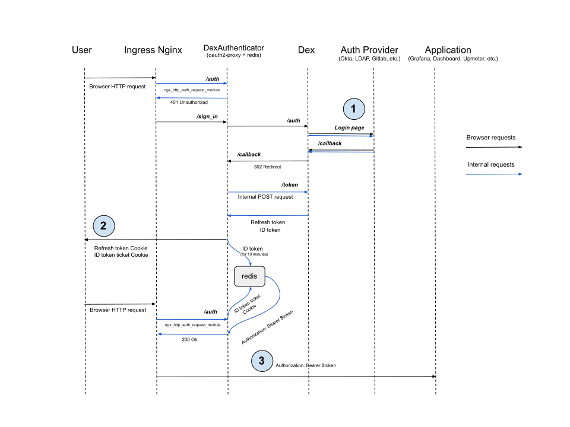
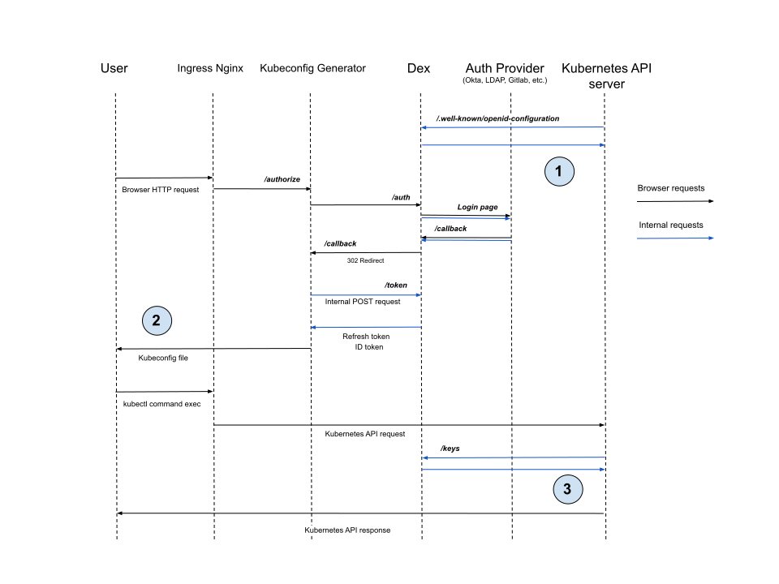

## How to secure my application?

To enable Dex authentication for your application, follow these steps:

1. Create a [DexAuthenticator](cr.html#dexauthenticator).

   When you create a [DexAuthenticator](cr.html#dexauthenticator) in a cluster, an instance of [oauth2-proxy](https://github.com/oauth2-proxy/oauth2-proxy) is created and connected to Dex. A Deployment, a Service and a Secret are created in the specified namespace, plus an Ingress if `applicationIngressClassName` is set and an HTTPRoute if `gatewayAPI` is set.

   Example of the DexAuthenticator custom resource:

   ```yaml
   apiVersion: deckhouse.io/v1
   kind: DexAuthenticator
   metadata:
     # Dex authenticator pod name prefix.
     # For example, if the name prefix is `app-name`, then Dex authenticator pods will look like `app-name-dex-authenticator-7f698684c8-c5cjg`.
     name: app-name
     # Namespace to deploy Dex authenticator to.
     namespace: app-ns
   spec:
     # Your application's domain. Requests to it will be redirected for Dex authentication.
     applicationDomain: "app-name.kube.my-domain.com"
     # A parameter that determines whether to send the `Authorization: Bearer` header to the application.
     # This one is useful in combination with auth_request in NGINX.
     # If sendAuthorizationHeader is true, add Authorization to the nginx.ingress.kubernetes.io/auth-response-headers annotation of the application's Ingress or to the alb.network.deckhouse.io/auth-response-headers annotation of its HTTPRoute.
     sendAuthorizationHeader: false
     # The name of the Secret containing the SSL certificate.
     applicationIngressCertificateSecretName: "ingress-tls"
     # The name of the Ingress class to use in the Ingress resource created for the Dex authenticator.
     applicationIngressClassName: "nginx"
     # The duration of the active user session.
     keepUsersLoggedInFor: "720h"
     # The list of groups whose users are allowed to authenticate.
     allowedGroups:
     - everyone
     - admins
     # The list of addresses and networks for which authentication is allowed.
     whitelistSourceRanges:
     - 1.1.1.1/32
     - 192.168.0.0/24
   ```

   To add labels and annotations to the `dex-authenticator` pods, for example to disable Istio sidecar injection, use [`spec.podMetadata`](cr.html#dexauthenticator-v1-spec-podmetadata):

   ```yaml
   spec:
     podMetadata:
       annotations:
         sidecar.istio.io/inject: "false"
   ```

1. Connect your application to Dex.

   To do this, add annotations to the resource through which the app is published. The set of annotations depends on how the application is published. Choose the relevant option:






Add the following annotations to the application's Ingress resource:

- `nginx.ingress.kubernetes.io/auth-signin: https://$host/dex-authenticator/sign_in`
- `nginx.ingress.kubernetes.io/auth-response-headers: X-Auth-Request-User,X-Auth-Request-Email`
- `nginx.ingress.kubernetes.io/auth-url: https://<SERVICE_NAME>.<NS>.svc.{{ C_DOMAIN }}/dex-authenticator/auth`, where:
  - `SERVICE_NAME`: Name of the authenticator's Service. Usually, it is `<NAME>-dex-authenticator` (`<NAME>` is the `metadata.name` of the [DexAuthenticator](/modules/user-authn/cr.html#dexauthenticator)).
  - `NS`: Value of the `metadata.namespace` parameter of the [DexAuthenticator](/modules/user-authn/cr.html#dexauthenticator).
  - `C_DOMAIN`: Cluster domain (the [clusterDomain](/products/kubernetes-platform/documentation/v1/reference/api/cr.html#clusterconfiguration-clusterdomain) parameter of the [ClusterConfiguration](/products/kubernetes-platform/documentation/v1/reference/api/cr.html#clusterconfiguration) resource).




If the DexAuthenticator `<NAME>` is too long, the Service name may be truncated. To find the correct service name, use the following command (specify the namespace name and DexAuthenticator name):

```shell
d8 k get service -n <NS> -l "deckhouse.io/dex-authenticator-for=<NAME>" -o jsonpath='{.items[0].metadata.name}'
```



Example of annotations for an application's Ingress resource for connecting to Dex:

```yaml
annotations:
  nginx.ingress.kubernetes.io/auth-signin: https://$host/dex-authenticator/sign_in
  nginx.ingress.kubernetes.io/auth-url: https://app-name-dex-authenticator.app-ns.svc.cluster.local/dex-authenticator/auth
  nginx.ingress.kubernetes.io/auth-response-headers: X-Auth-Request-User,X-Auth-Request-Email
```

An application that specifies only `applicationIngressClassName` gets no HTTPRoute. If Ingress publication is turned off with [`global.modules.ingress.enabled`](/products/kubernetes-platform/documentation/v1/reference/api/global.html#parameters-modules-ingress-enabled), it gets no Ingress either. The application itself stays reachable through the route you publish it with, but none of its `/dex-authenticator` endpoints are, so the redirect to sign in lands on the application and no one can log in. Other applications are unaffected.




If the application is published through an ALBInstance or ClusterALBInstance resource (for details, see the [`alb`](/modules/alb/) module documentation), add the following annotations to the application's HTTPRoute resource:

- `alb.network.deckhouse.io/auth-signin: https://<application-domain>/dex-authenticator/sign_in` — unlike nginx, the `alb` controller does not support the `$host` variable, so the application's domain must be specified explicitly.
- `alb.network.deckhouse.io/auth-response-headers: X-Auth-Request-User,X-Auth-Request-Email`.
- `alb.network.deckhouse.io/auth-url: https://<SERVICE_NAME>.<NS>.svc.<C_DOMAIN>/dex-authenticator/auth`, where `SERVICE_NAME`, `NS`, and `C_DOMAIN` are determined the same way as for an Ingress resource.

Example of annotations for an application's HTTPRoute resource for connecting to Dex:

```yaml
annotations:
  alb.network.deckhouse.io/auth-signin: https://app-name.kube.my-domain.com/dex-authenticator/sign_in
  alb.network.deckhouse.io/auth-url: https://app-name-dex-authenticator.app-ns.svc.cluster.local/dex-authenticator/auth
  alb.network.deckhouse.io/auth-response-headers: X-Auth-Request-User,X-Auth-Request-Email
```

Also, in the DexAuthenticator resource, specify the same ListenerSet used to publish the application's domain:

```yaml
spec:
  gatewayAPI:
    applicationHTTPRouteListenerSetName: my-listenerset
```

The HTTPRoute created for the DexAuthenticator attaches to that same ListenerSet, so the ListenerSet must accept routes from the namespace of the DexAuthenticator.

An application that specifies only `gatewayAPI` gets no Ingress. If Gateway API is turned off with [`global.modules.gatewayAPI.enabled`](/products/kubernetes-platform/documentation/v1/reference/api/global.html#parameters-modules-gatewayapi-enabled), or the cluster serves no HTTPRoute API, it gets no HTTPRoute either, with the same result: the application stays reachable, its `/dex-authenticator` endpoints do not, and no one can log in. Other applications are unaffected.





When setting `sendAuthorizationHeader: true`, list all necessary headers in the Ingress (or in the HTTPRoute, if the [`alb`](/modules/alb/) module is used) in the corresponding annotation, since the `Authorization` header is not transmitted by default.

For details on what is passed in the `Authorization` header and how to specify it in the annotation, see [How to pass the user's login and groups to an application](#how-to-pass-the-users-login-and-groups-to-an-application).



The application Ingress must have TLS configured. DexAuthenticator does not support HTTP-only Ingress resources.


### Setting up CIDR-based restrictions

To allow authentication only from specific networks, list them in [`whitelistSourceRanges`](cr.html#dexauthenticator-v1-spec-whitelistsourceranges). The limit applies to the `/dex-authenticator` endpoints. To restrict access to the application itself, or to let some networks in without authentication, use the annotations of the application's Ingress:

* To restrict access by IP and keep Dex authentication, add the annotation with a comma-separated list of allowed CIDRs:

  ```yaml
  nginx.ingress.kubernetes.io/whitelist-source-range: 192.168.0.0/32,1.1.1.1
  ```

* To allow access without Dex authentication for users from specified networks while requiring authentication for others, add the annotation:

  ```yaml
  nginx.ingress.kubernetes.io/satisfy: "any"
  ```

## How to pass the user's login and groups to an application?

By default DexAuthenticator passes only two headers to the application: `X-Auth-Request-User` (based on the opaque `sub` claim) and `X-Auth-Request-Email`. The user's groups are not passed as a header. It grows unboundedly with the number of groups, so it is disabled in DP, and it cannot be enabled.

To give the application full information about the user, including groups, enable [`sendAuthorizationHeader`](cr.html#dexauthenticator-v1-spec-sendauthorizationheader):

```yaml
apiVersion: deckhouse.io/v1
kind: DexAuthenticator
metadata:
  name: app-name
  namespace: app-ns
spec:
  applicationDomain: "app-name.kube.my-domain.com"
  applicationIngressClassName: "nginx"
  applicationIngressCertificateSecretName: "ingress-tls"
  sendAuthorizationHeader: true
```

In this case, the application receives the `Authorization: Bearer <id_token>` header, where `<id_token>` is a JWT signed by Dex (for details on the token contents and how to process it in your application, see [JWT token contents and processing considerations](#jwt-token-contents-and-processing-considerations)).

Regardless of how the application is published, this header is not passed to the application automatically. It must be explicitly listed in the annotation of the resource through which the application is published. Choose the relevant option depending on how the application is published:




If the application is published through an Ingress resource (for details, see the [`ingress-nginx`](/modules/ingress-nginx/) module documentation), when setting `sendAuthorizationHeader: true`, you need to:

- Specify the headers to pass to the application in the `nginx.ingress.kubernetes.io/auth-response-headers` annotation.
- Also increase the buffer size using the `nginx.ingress.kubernetes.io/proxy-buffer-size` annotation, since a JWT with many groups does not fit into the default buffer.

Example of specifying the headers and buffer size using the corresponding annotations:



```yaml
annotations:
  nginx.ingress.kubernetes.io/auth-signin: https://$host/dex-authenticator/sign_in
  nginx.ingress.kubernetes.io/auth-url: https://app-name-dex-authenticator.app-ns.svc.cluster.local/dex-authenticator/auth
  nginx.ingress.kubernetes.io/auth-response-headers: X-Auth-Request-User,X-Auth-Request-Email,Authorization
  nginx.ingress.kubernetes.io/proxy-buffer-size: 32k
```



If the `Authorization` header is not listed in `auth-response-headers`, the application won't receive it. If `proxy-buffer-size` is not increased, requests will fail with a 500 error, and the Ingress controller log will show `upstream sent too big header while reading response header from upstream`.




If the application is published through an ALBInstance or ClusterALBInstance resource (for details, see the [`alb`](/modules/alb/) module documentation), when setting `sendAuthorizationHeader: true`, specify the headers to pass to the application in the `alb.network.deckhouse.io/auth-response-headers` annotation of the HTTPRoute resource:

```yaml
annotations:
  alb.network.deckhouse.io/auth-signin: https://app-name.kube.my-domain.com/dex-authenticator/sign_in
  alb.network.deckhouse.io/auth-url: https://app-name-dex-authenticator.app-ns.svc.cluster.local/dex-authenticator/auth
  alb.network.deckhouse.io/auth-response-headers: Authorization
```

For the `alb.network.deckhouse.io/auth-response-headers` annotation, it is enough to specify only `Authorization`, since it already passes the base set of headers by default.

Also, in the DexAuthenticator resource, specify the same ListenerSet used to publish the application's domain:

```yaml
spec:
  gatewayAPI:
    applicationHTTPRouteListenerSetName: my-listenerset
```




### JWT token contents and processing considerations

Example of the JWT payload for a static user (the [User](cr.html#user) and [Group](cr.html#group) resources):

```json
{
  "iss": "https://dex.kube.my-domain.com/",
  "sub": "Cg1qb2huLmRvZUBleGFtcGxlEgVsb2NhbA",
  "aud": "dex-authenticator-app-name@app-ns",
  "exp": 1757000600,
  "iat": 1757000000,
  "email": "john.doe@example.com",
  "email_verified": true,
  "name": "john-doe",
  "preferred_username": "",
  "groups": ["everyone", "developers"]
}
```

When parsing the token in your application, keep in mind the following:

- Use the `email` field to identify the user. The `sub` field is opaque (it is not predictable and cannot be used as a meaningful user identifier outside the context of a specific system), and `preferred_username` is empty for static users (external authentication providers may populate it).
- The `name` field contains the object's name (from the `metadata.name` field of the [User](cr.html#user) object), not the user's display name.
- The `aud` field contains the authenticator client identifier (`dex-authenticator-<name>@<namespace>`), not your application's own OIDC client identifier. An application that validates `aud` against its own `client_id` will reject such a token.
- Verify the signature with the JWKS endpoint `https://<DEX_DOMAIN>/keys`, where `<DEX_DOMAIN>` is the [`publicDomainTemplate`](/products/kubernetes-platform/documentation/v1/reference/api/global.html#parameters-modules-publicdomaintemplate) value with `%s` replaced by `dex`.
- The token's lifetime is defined by the [`idTokenTTL`](configuration.html#parameters-idtokenttl) parameter (10 minutes by default). DexAuthenticator refreshes the token on its own, so the application always gets a current one.

If the application supports OIDC on its own, use the [DexClient](cr.html#dexclient) resource instead of DexAuthenticator: the application will request the required scope itself and get a `refresh_token` in addition to the `id_token`.

## Authentication flow with DexAuthenticator



DexAuthenticator sets its cookies with the `Secure` attribute, so they are sent only over HTTPS.

1. Dex redirects the user to the provider's login page in most cases and waits for the user to be redirected back to the `/callback` URL. However, some providers like LDAP or Atlassian Crowd do not support this flow. The user must enter credentials in the Dex login form instead, and Dex will validate them by making a request to the provider's API.

1. DexAuthenticator starts the sign-in with Proof Key for Code Exchange (PKCE) using the `S256` method and gets the tokens and the signing keys from the `dex` Service in the `d8-user-authn` namespace. It checks the certificate of Dex against the certificate authority (CA) of the internal Dex certificate. `user-authn` adds this CA to the Secret of every DexAuthenticator.

1. DexAuthenticator sets the cookie with the full refresh token (instead of issuing a ticket as for the ID token) because Redis does not persist data.
   If no ID token is found in Redis by the ticket, the user can request a new ID token by providing the refresh token from the cookie.

1. DexAuthenticator sets the `Authorization` HTTP header to the ID token value from Redis. This is not required for services like [`upmeter`](/modules/upmeter/), as `upmeter` permissions are less granular.
   For the [Kubernetes Dashboard](/modules/dashboard/), it is critical: the Dashboard passes the ID token on to access the Kubernetes API.

### Handling an expired session in a single-page application

Without a session, a request to the application is redirected to the sign-in page from the `auth-signin` annotation (`/dex-authenticator/sign_in`). DexAuthenticator sends the user to Dex only when the browser navigates to that page. A request with the `Sec-Fetch-Mode: navigate` header is a navigation. If the browser does not send `Sec-Fetch-Mode`, a request without the `Accept: application/json` and `X-Requested-With: XMLHttpRequest` headers is a navigation. A script request (`fetch`, XHR) gets the `401` status code with the `{}` body instead of a redirect to Dex, which the browser would block as a cross-origin request.

To send the user to sign in, reload the page when a script request gets `401`:

```javascript
const response = await fetch("/api/items");
if (response.status === 401) {
  window.location.reload();
}
```

### Ending a DexAuthenticator session

DexAuthenticator ends the sessions of a user within seconds after a `Lock`, `ResetPassword`, `Reset2FA` or `Logout` operation and after the user is deleted. A request with an ended session gets the same answer as a request without a session.

DexAuthenticator receives the revocations from the `revocation-feed` Service in the `d8-user-authn` namespace. If a NetworkPolicy restricts egress traffic in the namespace of a DexAuthenticator, allow traffic to the pods with the `app: user-authn-controller` label in the `d8-user-authn` namespace on port `8443`. Without the revocations, DexAuthenticator checks every session older than 30 seconds with Dex, and the `D8UserAuthnRevocationFeedNotConsumed` alert fires after 15 minutes.

When a user signs out of an application, DexAuthenticator revokes the refresh token of the session in Dex. A copy of the session cookie stops working too.

With the [browser sessions of Dex](usage.html#browser-sessions-of-dex) enabled, DexAuthenticator then sends the browser to Dex to end the session of Dex, and the browser is signed out of the other applications it signed in to through this session. Sign the user out with a navigation, not with a script request, which does not follow the redirect to Dex:

```javascript
window.location.assign("/dex-authenticator/sign_out");
```

## How to generate a kubeconfig and access Kubernetes API?

To generate a kubeconfig, refer to the [«How to generate a kubeconfig to access the Kubernetes API?»](/modules/control-plane-manager/faq.html#how-to-generate-a-kubeconfig-to-access-the-kubernetes-api) section of the `control-plane-manager` module documentation.

### Configuring kube-apiserver

Using the [`control-plane-manager`](/modules/control-plane-manager/) module, DP passes `kube-apiserver` an AuthenticationConfiguration with a JWT authenticator for Dex: issuer `https://<DEX_DOMAIN>/` (where `<DEX_DOMAIN>` is the `publicDomainTemplate` value with `%s` replaced by `dex`), audience `kubernetes`, the username from the `email` claim and the groups from the `groups` claim. If [`controlPlaneConfigurator.dexCAMode`](configuration.html#parameters-controlplaneconfigurator-dexcamode) provides a CA, it is embedded in the configuration. Usernames and groups that start with `system:` are rejected.

### The flow of accessing Kubernetes API with generated kubeconfig



1. `kube-apiserver` reads the Dex configuration (issuer and JWKS endpoint). In Kubernetes 1.30 and later, it reads it through the Dex Service inside the cluster.

1. The kubeconfig generated in the Deckhouse web UI contains the ID token and the refresh token.

1. After receiving a request with an ID token, `kube-apiserver` verifies that the token is signed by the provider configured in step 1 using keys from the JWKS endpoint. It then compares the token's `iss` and `aud` claim values with the configuration.

## How to rotate the secret of the kubernetes OAuth2 client?

The secret of the privileged `kubernetes` OAuth2 client is stored in the `kubernetes-dex-client-app-secret` Secret of the `d8-user-authn` namespace. The same value is used by the `kubeconfig-generator`, `kubeconfig-generator-<index>`, `kubeconfig-publish-api` and `kubeconfig-<slug>` OAuth2 clients, and by basic-auth-proxy when basic authentication is enabled for an LDAP provider.

Deleting the Secret does not rotate the value: while it is still present in the module's values, the owning hook renders the very same one back.

To rotate the secret, do the following:

1. If a GitOps tool controls the `d8-user-authn` namespace, exclude the `kubernetes-dex-client-app-secret` Secret from syncing. Otherwise the GitOps tool will restore the previous value.

1. Empty the `secret` field:

   ```shell
   d8 k -n d8-user-authn patch secret kubernetes-dex-client-app-secret --type merge -p '{"data":{"secret":""}}'
   ```

1. Restart DP so that the hook picks the empty field up and generates a new value:

   ```shell
   d8 k -n d8-system rollout restart deployment/deckhouse
   ```

1. Verify that the secret value changed:

   ```shell
   d8 k -n d8-user-authn get secret kubernetes-dex-client-app-secret -o jsonpath='{.data.secret}'
   ```

   If it did not, repeat the steps 2 and 3. The module may have restored the previous value before DP was restarted.

Once the secret has been rotated, the configuration of components that use it will be updated automatically and the corresponding pods will be restarted.

Kubeconfig files generated in the Deckhouse web UI before the rotation carry the old client secret and stop refreshing tokens. Generate them again. ID tokens issued before the rotation keep working until they expire, which is configured via [`settings.idTokenTTL`](configuration.html#parameters-idtokenttl) (10 minutes by default).

## How to enable Kerberos (SPNEGO) SSO for LDAP?

If clients run in a corporate SSO environment (browser trusts the Dex host), Dex can accept Kerberos tickets via `Authorization: Negotiate` and log in without the password form.

Enabling Kerberos (SPNEGO) SSO for LDAP:

1. In AD/KDC, create/provision an SPN `HTTP/<DEX_FQDN>` for a service account and generate a `keytab`.
1. In the cluster, create a Secret in the `d8-user-authn` namespace with the `krb5.keytab` data key.
1. In the LDAP DexProvider resource, enable [`spec.ldap.kerberos`](/modules/user-authn/cr.html#dexprovider-v1-spec-ldap-kerberos):
   - `enabled: true`
   - `keytabSecretName: <secret name>`
   - optional: `expectedRealm`, `usernameFromPrincipal`, `fallbackToPassword`

Dex will mount the `keytab` automatically and start accepting SPNEGO. A server‑side `krb5.conf` is not required — tickets are validated using the keytab.

## How to configure Basic Authentication for accessing Kubernetes API via LDAP?

Use the `control-plane-manager` module settings:

1. Enable the [`apiserver.publishAPI`](/modules/control-plane-manager/configuration.html#parameters-apiserver-publishapi) parameter in the `control-plane-manager` module configuration.
1. Create a [DexProvider](cr.html#dexprovider) of type `LDAP` and set [`enableBasicAuth: true`](cr.html#dexprovider-v1-spec-ldap-enablebasicauth).
1. Grant the LDAP groups access with a RoleBinding or ClusterRoleBinding of the [granular role-based model](/modules/user-authz/#granular-role-based-model).
1. Provide users with a kubeconfig configured for Basic Authentication (LDAP username and password).


Only one authentication provider in the cluster can have [`enableBasicAuth`](cr.html#dexprovider-v1-spec-ldap-enablebasicauth) enabled.


A detailed example is described in the [Usage](/modules/user-authn/usage.html#configuring-basic-authentication) section.

## How is Dex protected against credential brute-forcing?

Dex limits failed sign-in attempts per client IP address on the sign-in form, the token endpoint, the password change page and the 2FA steps. Configure the limit with the [`rateLimit`](configuration.html#parameters-ratelimit) parameter. It is turned off by default.

Dex also locks an account after failed sign-in attempts. Configure the lockout with the [`passwordPolicy.lockout`](configuration.html#parameters-passwordpolicy-lockout) parameter. It applies to local users, and to LDAP and Crowd users if their types are listed in [`applyToConnectors`](configuration.html#parameters-passwordpolicy-lockout-applytoconnectors).

## Which client address does Dex see?

Dex uses the address of the client in three places:

* the limit of failed attempts per address ([`rateLimit`](configuration.html#parameters-ratelimit));
* the sign-in log (the `client_remote_addr` key);
* the devices of a user ([`ipAddress`](cr.html#useraccount-v1alpha1-status-sessions-ipaddress) in the UserAccount object).

Dex takes the address that the Ingress controller of the platform passes on (see [`rateLimit`](configuration.html#parameters-ratelimit) for the headers it trusts). So the address is right only when the Ingress controller sees the address of the client itself. A balancer in front of the Ingress controller that replaces the address of the client with its own hides it. Then Dex sees the address of the balancer for every user:

* the limit counts the failed attempts of all users together, so the failures of one user can make Dex refuse the sign-ins of the others;
* the sign-in log and the devices of a user show the address of the balancer.

To pass the address of the client to the Ingress controller, configure the [IngressNginxController](/modules/ingress-nginx/cr.html#ingressnginxcontroller) object:

* if the balancer supports the PROXY protocol, use an inlet with it, such as `LoadBalancerWithProxyProtocol` or `HostPortWithProxyProtocol`;
* if the requests come through an HTTP proxy that adds the `X-Forwarded-For` header, enable `behindL7Proxy` for the inlet and list the addresses of the proxy in `acceptClientIPHeadersFrom`. The `realIPHeader` parameter selects another header and works only with `behindL7Proxy`.

To check the address Dex sees, sign in and compare the `client_remote_addr` key of the `login successful` line in the Dex log with the address of your computer.

## How to find out why a sign-in was refused?

Dex logs every sign-in in JSON. A refused sign-in is logged at the `WARN` level with the `reason` field:

* `invalid_credentials`: The login or the password is wrong, or the password change page was opened outside the sign-in that led to it.
* `invalid_totp`: The 2FA code is wrong or has already been used.
* `not_in_allowed_groups`: The user is not in the groups that the provider settings require.
* `not_allowed`: The user is not on an allow-list. The `rule` field names the list.
* `account_locked`: The user is locked.
* `rate_limited`: Too many failed attempts came from the client IP address. The line contains the requested `path` instead of the provider, the client and the user.
* `upstream_refused`: The provider refused to extend the session because the user no longer exists in the provider or has lost access.
* `revoked`: The refresh token, the authorization code or the browser session was issued before a `Lock`, `ResetPassword`, `Reset2FA` or `Logout` operation or before the user was deleted.

The line also contains `connector_id`, `client_id` and the known user attributes, such as `username` and `email`. A group refusal also contains `user_groups` and `allowed_groups`. A failure of Dex or of the provider is logged at the `ERROR` level.

To find the refusals in the Dex logs, run:

```shell
d8 k -n d8-user-authn logs -l app=dex -c dex --tail=-1 | grep '"reason"'
```

## A UserOperation is in the Failed status — what should I do?

Check the `status.message` field of the UserOperation for the error description:

```shell
d8 k get useroperation <name> -o jsonpath='{.status.message}'
```

Fix the cause (for example, an invalid password hash or a non-existent user), then create a new UserOperation. A UserOperation runs once, and changes to its spec after creation are ignored.

## How do I unlock a user?

Use the command:

```shell
d8 iam user unlock <USERNAME>
```

The command unlocks a local user. To unlock a user of an external provider, create a UserOperation with `type: Unlock` and [`spec.target`](cr.html#useroperation-v1-spec-target) as described in [Operations on external users](usage.html#operations-on-external-users). A UserOperation with `spec.user` unlocks a local user as well. The `Lock` operation has already ended the sessions of the user, and `Unlock` does not restore them, so the user signs in again. Only `Reset2FA` removes the user's 2FA secret.

## A user was locked automatically — why?

The number of failed login attempts exceeded [`passwordPolicy.lockout.maxAttempts`](configuration.html#parameters-passwordpolicy-lockout-maxattempts). The user is locked for the duration specified in [`passwordPolicy.lockout.lockDuration`](configuration.html#parameters-passwordpolicy-lockout-lockduration) and is unlocked automatically afterwards. Local users are always covered. LDAP and Crowd users are locked only if their type is listed in [`passwordPolicy.lockout.applyToConnectors`](configuration.html#parameters-passwordpolicy-lockout-applytoconnectors). Dex stores the lock itself and does not create a UserOperation. An administrator can also unlock the user manually with `d8 iam user unlock <USERNAME>` (local users) or by creating a UserOperation with `type: Unlock` (with `spec.user` for local users, with `spec.target` for LDAP and Crowd users).

The `Locked` and `LockedUntil` columns of `d8 k get useraccounts` show whether a user is locked and until when. The module keeps a [UserAccount](cr.html#useraccount) object for each local user and for each user who has signed in through an external provider.

## Can I delete a UserIdentity object?

No. Dex keeps the 2FA secret, the lock and the last sign-in of an account in a UserIdentity object in the `d8-user-authn` namespace. The object also holds the generation of the account in the `user-authn.deckhouse.io/generation` annotation, which the module uses to revoke the account's tokens. The module refuses a request to delete a UserIdentity. To remove a local user, delete the User. To reset 2FA or a lock, use a UserOperation of the `Reset2FA` or `Unlock` type.

## Can I cancel a UserOperation?

No. A UserOperation runs once. To reverse its effect, create an opposite operation, for example a UserOperation with `type: Unlock` after a `Lock` operation.
