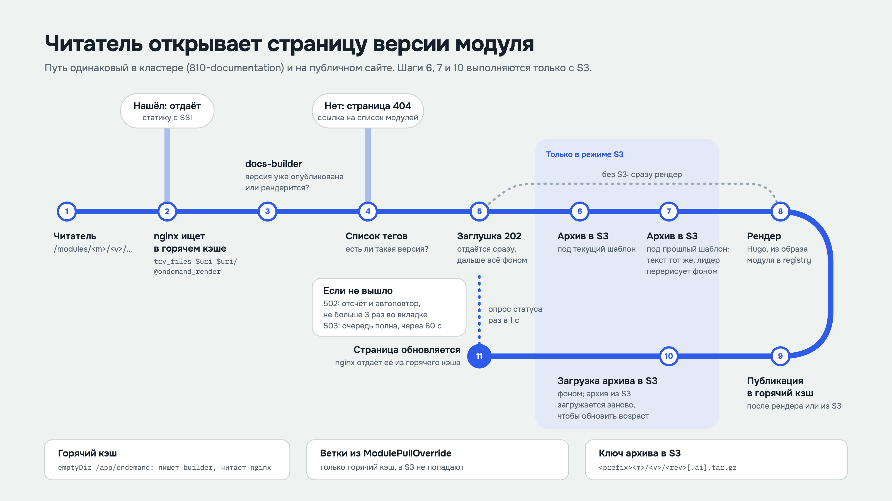
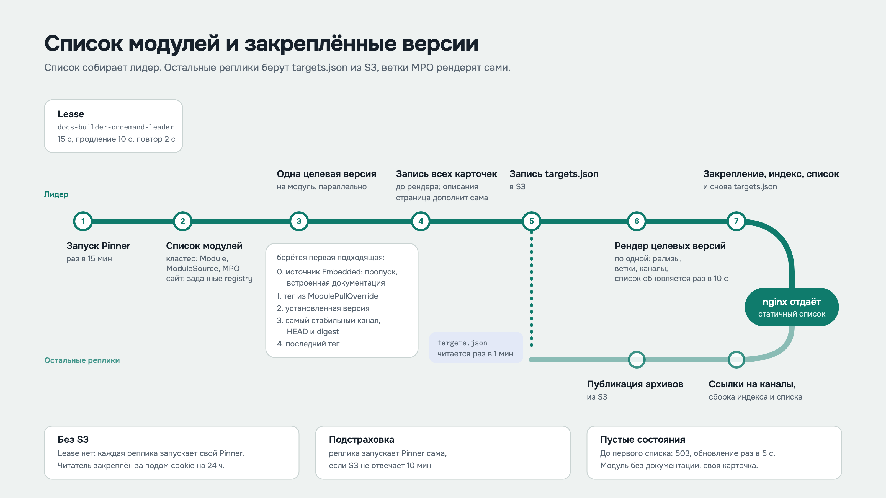
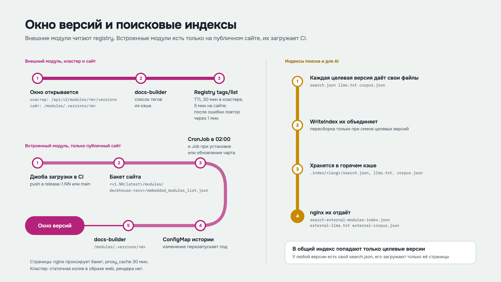
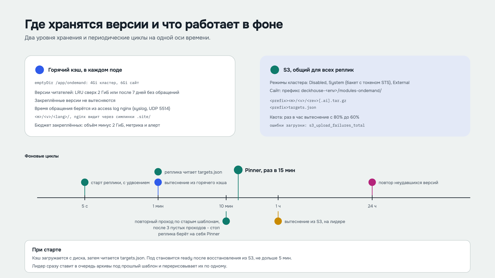
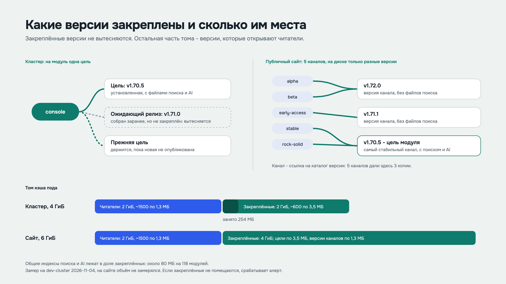

# On-demand documentation: internal flow

How docs-builder finds, renders and stores module documentation in the cluster (810-documentation) and on the public site. The slides are in Russian; the page with their headings is [ONDEMAND_FLOW_RU.md](ONDEMAND_FLOW_RU.md), the source is [ONDEMAND_FLOW_ru.html](ONDEMAND_FLOW_ru.html).

1. A reader opens a page of a module version: 
2. The modules list and the pinned versions: 
3. The versions dialog and the search indexes: 
4. Where versions live and what runs in the background: 
5. Pinned versions and the cache volume: 
