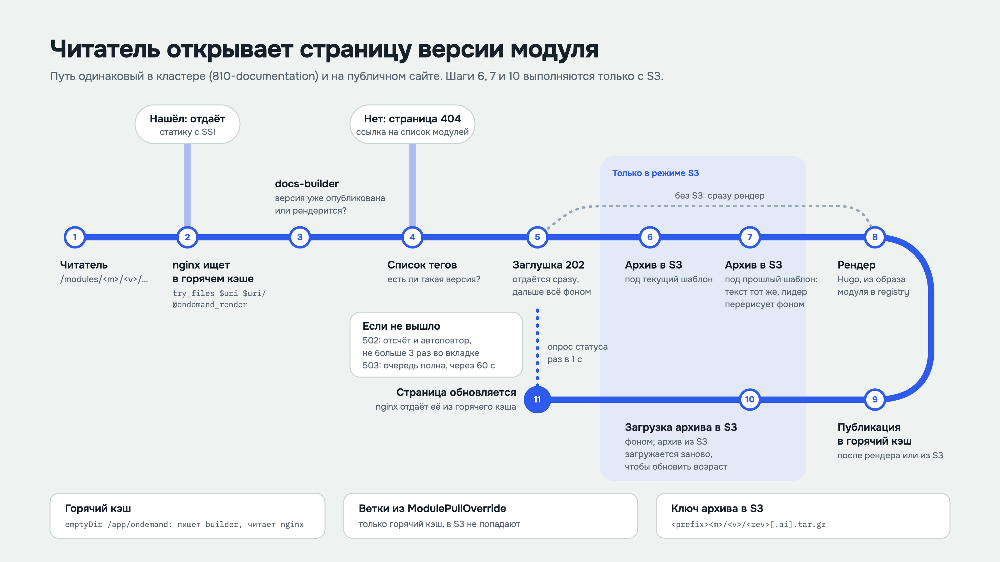
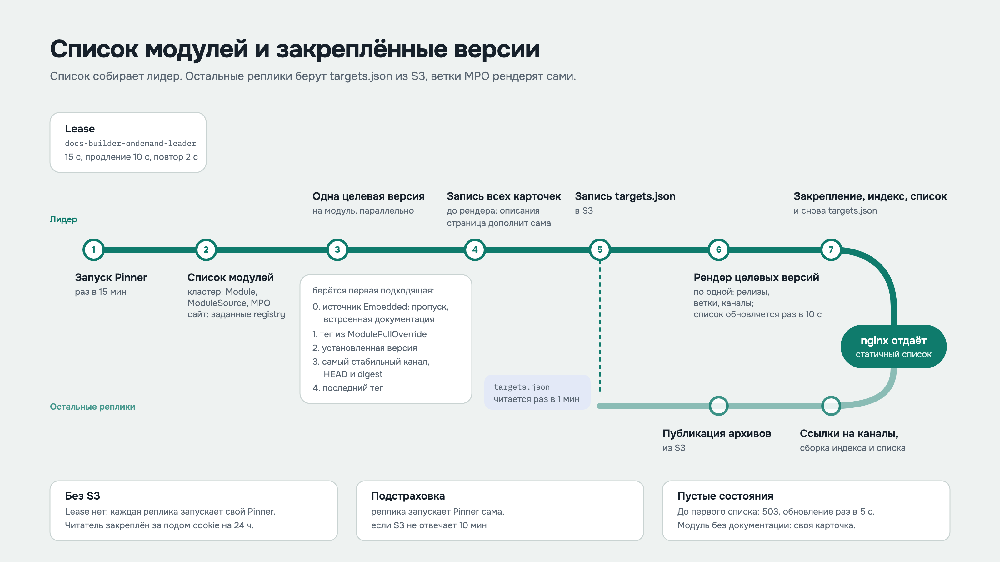
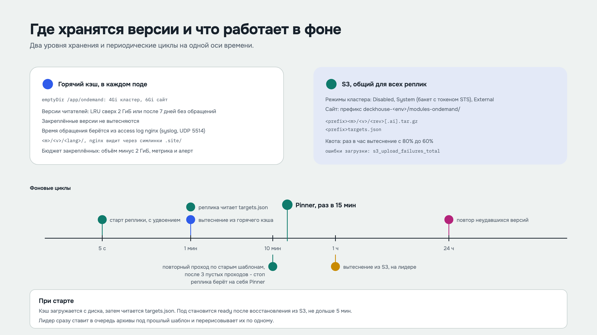
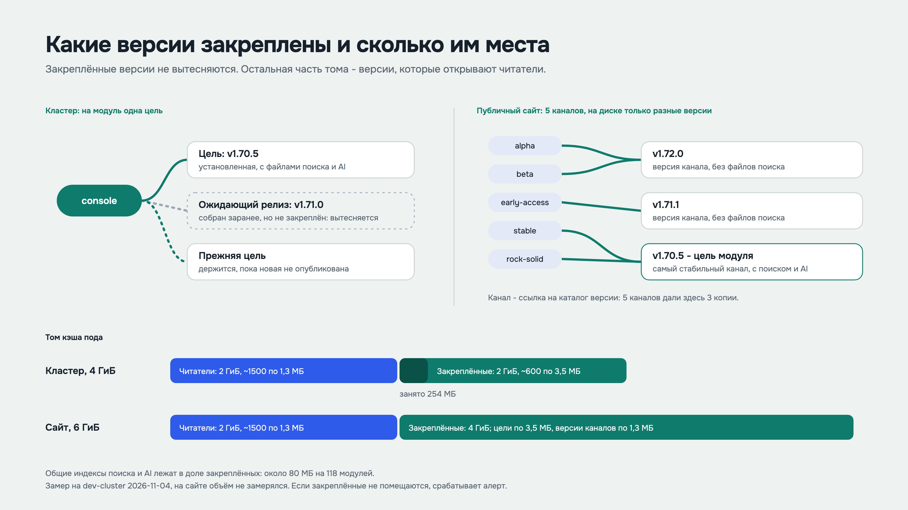

# Документация по запросу: внутренний flow

Как docs-builder находит, рендерит и хранит документацию модулей в кластере (810-documentation) и на публичном сайте. Исходник картинок - [ONDEMAND_FLOW_ru.html](ONDEMAND_FLOW_ru.html): параметр `?slide=N` (1-5) показывает один слайд. После правки исходника PNG снимаются заново:

```bash
for i in 1 2 3 4 5; do
  "/Applications/Google Chrome.app/Contents/MacOS/Google Chrome" --headless=new --hide-scrollbars \
    --force-device-scale-factor=2 --window-size=1600,900 --virtual-time-budget=4000 \
    --screenshot="ONDEMAND_FLOW-$i.png" "file://$PWD/ONDEMAND_FLOW_ru.html?slide=$i"
done
```

## Читатель открывает страницу версии модуля



## Список модулей и закреплённые версии



## Окно версий и поисковые индексы


## Где хранятся версии и что работает в фоне



## Какие версии закреплены и сколько им места


